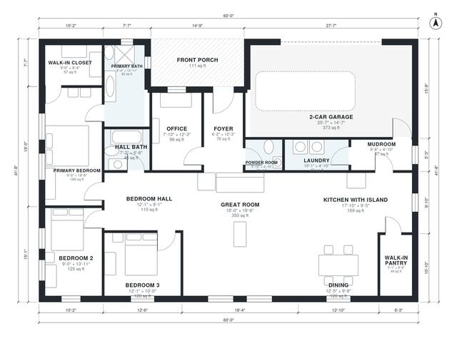

# 3 Bedroom Modern Farmhouse Plans: 1,960 Sq Ft, 2.5 Bath

A single-story modern farmhouse of about 182 m² (roughly 1,960 sq ft) of living space, plus a 40 m² attached 2-car garage and a front porch. The open great room, island kitchen with walk-in pantry, and dining area sit at the center. The primary suite and two bedrooms are in a quiet wing off a hall, and the office is at the front by the entry. A garage-side mudroom and laundry complete the plan.

| | |
|---|---|
| Levels | 1 |
| Footprint | 18.3 m × 12.7 m (60 ft × 42 ft) |
| Rooms | 17 indoor, 1 outdoor |
| Indoor area including garage, from the room grid | about 222 m² (2,390 sq ft) |

## Files here

- `area-schedule.csv` (room schedule)
- `building.json` (rooms, walls, openings as data)
- `plan-level1.dxf` (floor plan, DXF, drawing units: inches)

## More for this plan

- Plan page with the PDF plan set, IFC and 3D model, and a tool to change the plan: https://floorplan.ai-architectures.com/house-plans/3-bedroom-modern-farmhouse-plans?utm_source=github-plans&utm_medium=probe&utm_campaign=github
- PDF plan set: https://storage.googleapis.com/20img/house-plans/3-bedroom-modern-farmhouse-plans/plan-set.pdf
- IFC model: https://storage.googleapis.com/20img/house-plans/3-bedroom-modern-farmhouse-plans/model.ifc

## Known issues in this drawing

- Front Porch is not on the street side.
- Primary Bedroom is only 2.74 m wide.

Concept design generated with AI. Not for construction or permit; verify with a licensed professional.
