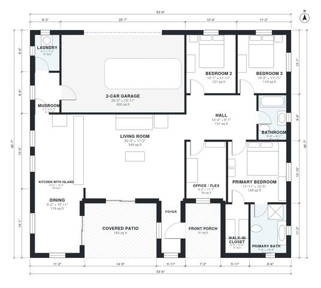

# 3 Bedroom Modern House Plans: 1,810 Sq Ft Single-Story

This is a single-story modern home of roughly 167 m² (1,800 sq ft) of conditioned space, plus an attached 2-car garage, front porch and covered rear patio. An open kitchen with an island, dining area and large living room form the heart of the plan. The three bedrooms sit in a private wing off a central hall, and the primary suite has its own bath and walk-in closet. The garage enters through a mudroom beside the laundry.

| | |
|---|---|
| Levels | 1 |
| Footprint | 16.3 m × 14.2 m (53 ft × 47 ft) |
| Rooms | 15 indoor, 2 outdoor |
| Indoor area including garage, from the room grid | about 209 m² (2,246 sq ft) |

## Files here

- `area-schedule.csv` (room schedule)
- `building.json` (rooms, walls, openings as data)
- `plan-level1.dxf` (floor plan, DXF, drawing units: inches)

## More for this plan

- Plan page with the PDF plan set, IFC and 3D model, and a tool to change the plan: https://floorplan.ai-architectures.com/house-plans/3-bedroom-modern-house-plans?utm_source=github-plans&utm_medium=probe&utm_campaign=github
- PDF plan set: https://storage.googleapis.com/20img/house-plans/3-bedroom-modern-house-plans/plan-set.pdf
- IFC model: https://storage.googleapis.com/20img/house-plans/3-bedroom-modern-house-plans/model.ifc

## Known issues in this drawing

- Foyer is 3.6 m² (asked for about 6.0 m²).
- Foyer is only 1.20 m wide.
- Laundry is 3.4 m² (asked for about 5.0 m²).

Concept design generated with AI. Not for construction or permit; verify with a licensed professional.
