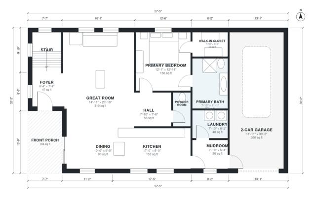

# 3 Bedroom Mountain House Plans: 2,070 Sq Ft, 2.5 Bath

This story-and-a-half mountain house has about 190 m² (roughly 2,050 sq ft) of living space, plus a 2-car garage and a front porch. The main floor has an open great room, kitchen and dining area, a mudroom with laundry beside the garage, a powder room and a private primary suite with bath and walk-in closet. Upstairs are two bedrooms, a bath and a loft.

| | |
|---|---|
| Levels | 2 |
| Footprint | 17.5 m × 9.8 m (57 ft × 32 ft) |
| Rooms | 19 indoor, 2 outdoor |
| Indoor area including garage, from the room grid | about 231 m² (2,491 sq ft) |

## Files here

- `area-schedule.csv` (room schedule)
- `building.json` (rooms, walls, openings as data)
- `plan-level1.dxf` (floor plan, DXF, drawing units: inches)
- `plan-level2.dxf` (floor plan, DXF, drawing units: inches)

## More for this plan

- Plan page with the PDF plan set, IFC and 3D model, and a tool to change the plan: https://floorplan.ai-architectures.com/house-plans/3-bedroom-mountain-house-plans?utm_source=github-plans&utm_medium=probe&utm_campaign=github
- PDF plan set: https://storage.googleapis.com/20img/house-plans/3-bedroom-mountain-house-plans/plan-set.pdf
- IFC model: https://storage.googleapis.com/20img/house-plans/3-bedroom-mountain-house-plans/model.ifc

## Known issues in this drawing

- Foyer is 4.3 m² (asked for about 6.0 m²).

Concept design generated with AI. Not for construction or permit; verify with a licensed professional.
