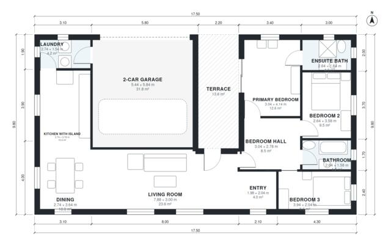

# 3 Bedroom One Story House Plans with Garage | 1,310 Sq Ft

A compact single-storey home on a 15 x 11.4 m footprint, with about 120 m² of living space plus an attached 2-car garage and a covered terrace. The open kitchen with island, dining and living area flows out to the terrace. Three bedrooms (including a primary suite with ensuite) and a family bathroom sit in a quiet wing off a central hall, and the garage connects to the house through the laundry.

| | |
|---|---|
| Levels | 1 |
| Footprint | 17.5 m × 9.8 m (57 ft × 32 ft) |
| Rooms | 12 indoor, 1 outdoor |
| Indoor area including garage, from the room grid | about 158 m² (1,699 sq ft) |

## Files here

- `area-schedule.csv` (room schedule)
- `building.json` (rooms, walls, openings as data)
- `plan-level1.dxf` (floor plan, DXF, drawing units: millimetres)

## More for this plan

- Plan page with the PDF plan set, IFC and 3D model, and a tool to change the plan: https://floorplan.ai-architectures.com/house-plans/3-bedroom-one-story-house-plans-with-garage?utm_source=github-plans&utm_medium=probe&utm_campaign=github
- PDF plan set: https://storage.googleapis.com/20img/house-plans/3-bedroom-one-story-house-plans-with-garage/plan-set.pdf
- IFC model: https://storage.googleapis.com/20img/house-plans/3-bedroom-one-story-house-plans-with-garage/model.ifc

## Known issues in this drawing

- Living room is only 3.00 m wide.
- Bedroom 3 is only 2.04 m wide.

Concept design generated with AI. Not for construction or permit; verify with a licensed professional.
