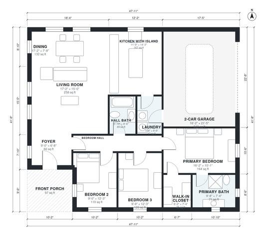

# 3 Bedroom One Story House Plans: 1,510 Sq Ft, 2-Car Garage

This single-story ranch is about 163 m² (1,750 sq ft) of living space, plus a 2-car garage and a front porch. An open kitchen with island, dining and living area runs along the front of the house. The primary suite with its bath and walk-in closet is separate from the two secondary bedrooms and the shared hall bath. The laundry sits between the kitchen and the garage and doubles as the garage entry.

| | |
|---|---|
| Levels | 1 |
| Footprint | 14.6 m × 12.7 m (48 ft × 42 ft) |
| Rooms | 13 indoor, 1 outdoor |
| Indoor area including garage, from the room grid | about 176 m² (1,899 sq ft) |

## Files here

- `area-schedule.csv` (room schedule)
- `building.json` (rooms, walls, openings as data)
- `plan-level1.dxf` (floor plan, DXF, drawing units: inches)

## More for this plan

- Plan page with the PDF plan set, IFC and 3D model, and a tool to change the plan: https://floorplan.ai-architectures.com/house-plans/3-bedroom-one-story-house-plans?utm_source=github-plans&utm_medium=probe&utm_campaign=github
- PDF plan set: https://storage.googleapis.com/20img/house-plans/3-bedroom-one-story-house-plans/plan-set.pdf
- IFC model: https://storage.googleapis.com/20img/house-plans/3-bedroom-one-story-house-plans/model.ifc

## Known issues in this drawing

- Dining is only 2.34 m wide.

Concept design generated with AI. Not for construction or permit; verify with a licensed professional.
