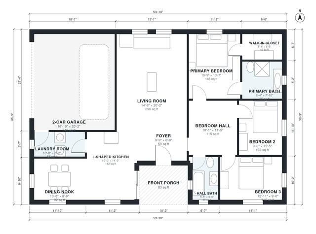

# 3 Bedroom Ranch House Plans: 1,510 Sq Ft, 2 Bath, Garage

This is a single-story ranch of about 41 ft x 48.5 ft overall. The living space is roughly 1,500 sq ft, plus a 2-car garage and a covered front porch. An open L-shaped kitchen, dining nook and living room run along the north side. The three bedrooms and two baths are grouped off a central hall, with a primary suite at the southeast corner. The laundry room links the kitchen to the garage.

| | |
|---|---|
| Levels | 1 |
| Footprint | 16.4 m × 11.2 m (54 ft × 37 ft) |
| Rooms | 13 indoor, 1 outdoor |
| Indoor area including garage, from the room grid | about 176 m² (1,894 sq ft) |

## Files here

- `area-schedule.csv` (room schedule)
- `building.json` (rooms, walls, openings as data)
- `plan-level1.dxf` (floor plan, DXF, drawing units: inches)

## More for this plan

- Plan page with the PDF plan set, IFC and 3D model, and a tool to change the plan: https://floorplan.ai-architectures.com/house-plans/3-bedroom-ranch-house-plans?utm_source=github-plans&utm_medium=probe&utm_campaign=github
- PDF plan set: https://storage.googleapis.com/20img/house-plans/3-bedroom-ranch-house-plans/plan-set.pdf
- IFC model: https://storage.googleapis.com/20img/house-plans/3-bedroom-ranch-house-plans/model.ifc

## Known issues in this drawing

- None found by the automatic checks.

Concept design generated with AI. Not for construction or permit; verify with a licensed professional.
