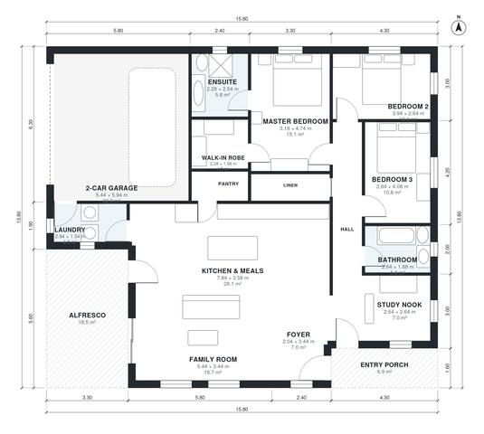

# 3 Bedroom Single Storey House Plans with Double Garage

This is a compact single-storey home on a rectangular footprint of about 15.8 x 13.8 m, with roughly 160 m² of living space plus the garage and alfresco. An open kitchen, meals and family area looks out to a covered alfresco. The three bedrooms, including the master suite with walk-in robe and ensuite, sit in a quiet wing off a central hall. A study nook, laundry and attached 2-car garage complete the brief.

| | |
|---|---|
| Levels | 1 |
| Footprint | 15.8 m × 13.8 m (52 ft × 45 ft) |
| Rooms | 15 indoor, 2 outdoor |
| Indoor area including garage, from the room grid | about 193 m² (2,074 sq ft) |

## Files here

- `area-schedule.csv` (room schedule)
- `building.json` (rooms, walls, openings as data)
- `plan-level1.dxf` (floor plan, DXF, drawing units: millimetres)

## More for this plan

- Plan page with the PDF plan set, IFC and 3D model, and a tool to change the plan: https://floorplan.ai-architectures.com/house-plans/3-bedroom-single-storey-house-plans-with-double-garage?utm_source=github-plans&utm_medium=probe&utm_campaign=github
- PDF plan set: https://storage.googleapis.com/20img/house-plans/3-bedroom-single-storey-house-plans-with-double-garage/plan-set.pdf
- IFC model: https://storage.googleapis.com/20img/house-plans/3-bedroom-single-storey-house-plans-with-double-garage/model.ifc

## Known issues in this drawing

- Kitchen & Meals has no window.

Concept design generated with AI. Not for construction or permit; verify with a licensed professional.
