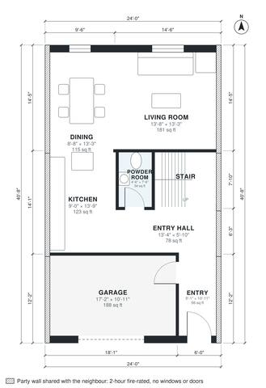

# 3 Bedroom Townhouse Plans: 1,730 Sq Ft, 2-Story, 24 ft Wide

A 24 ft wide mid-terrace townhouse of about 1,700 sq ft of living space plus a front 1-car garage. The ground floor has the garage and entry at the front, with a hall to the stair and powder room. The kitchen, dining and living room are open-plan at the rear, with large windows and a rear door. Upstairs are the primary suite, two bedrooms, a hall bath and laundry, all facing the front or rear. Built against the neighbours on the left and right (party walls, fire wall without windows or doors); the rooms take their daylight from the free sides.

| | |
|---|---|
| Levels | 2 |
| Footprint | 7.32 m × 12.4 m (24 ft × 41 ft) |
| Rooms | 16 indoor, 0 outdoor |
| Indoor area including garage, from the room grid | about 182 m² (1,954 sq ft) |

## Files here

- `area-schedule.csv` (room schedule)
- `building.json` (rooms, walls, openings as data)
- `plan-level1.dxf` (floor plan, DXF, drawing units: inches)
- `plan-level2.dxf` (floor plan, DXF, drawing units: inches)

## More for this plan

- Plan page with the PDF plan set, IFC and 3D model, and a tool to change the plan: https://floorplan.ai-architectures.com/house-plans/3-bedroom-townhouse-plans?utm_source=github-plans&utm_medium=probe&utm_campaign=github
- PDF plan set: https://storage.googleapis.com/20img/house-plans/3-bedroom-townhouse-plans/plan-set.pdf
- IFC model: https://storage.googleapis.com/20img/house-plans/3-bedroom-townhouse-plans/model.ifc

## Known issues in this drawing

- Kitchen has no window.

Concept design generated with AI. Not for construction or permit; verify with a licensed professional.
