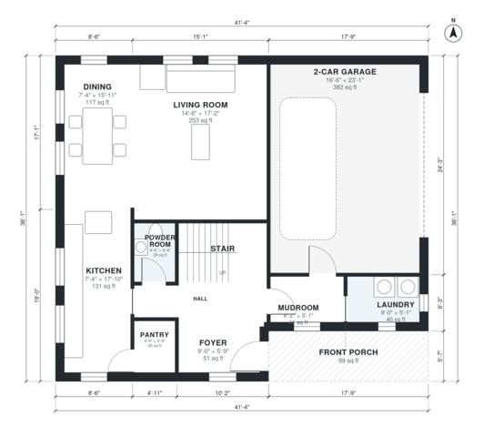

# 3 Bedroom Two Story House Plans: 1,970 Sq Ft with Garage

A two-story modern farmhouse of about 190 m² (roughly 2,050 sq ft) of living space, plus a 2-car garage and front porch. The ground floor has an open kitchen, dining and living area, powder room, laundry and a mudroom entry from the garage. Upstairs are three bedrooms, a primary suite with walk-in closet, a hall bath and a loft that opens onto a small balcony over the porch.

| | |
|---|---|
| Levels | 2 |
| Footprint | 12.6 m × 11.0 m (41 ft × 36 ft) |
| Rooms | 20 indoor, 2 outdoor |
| Indoor area including garage, from the room grid | about 223 m² (2,399 sq ft) |

## Files here

- `area-schedule.csv` (room schedule)
- `building.json` (rooms, walls, openings as data)
- `plan-level1.dxf` (floor plan, DXF, drawing units: inches)
- `plan-level2.dxf` (floor plan, DXF, drawing units: inches)

## More for this plan

- Plan page with the PDF plan set, IFC and 3D model, and a tool to change the plan: https://floorplan.ai-architectures.com/house-plans/3-bedroom-two-story-house-plans?utm_source=github-plans&utm_medium=probe&utm_campaign=github
- PDF plan set: https://storage.googleapis.com/20img/house-plans/3-bedroom-two-story-house-plans/plan-set.pdf
- IFC model: https://storage.googleapis.com/20img/house-plans/3-bedroom-two-story-house-plans/model.ifc

## Known issues in this drawing

- Dining is only 2.24 m wide.
- Foyer is 4.8 m² (asked for about 7.0 m²).
- Bedroom 3 is only 2.14 m wide.
- Bedroom 2 is 9.2 m² (asked for about 13.0 m²).

Concept design generated with AI. Not for construction or permit; verify with a licensed professional.
