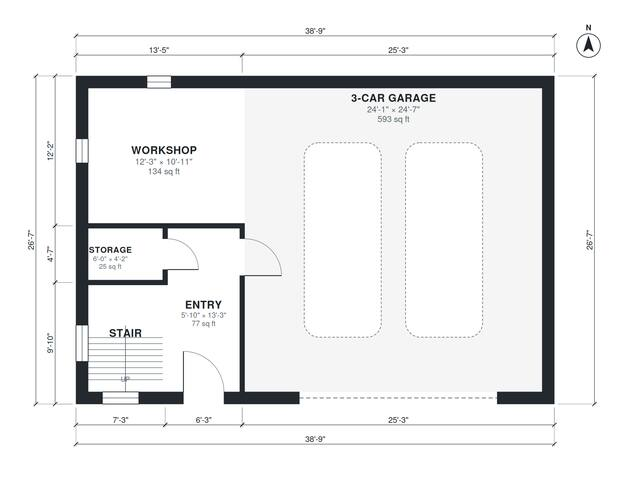

# 3 Car Garage With Apartment Above House Plan | 1,390 Sq Ft

A detached carriage-house garage of about 103 m² per floor (13.6 x 7.6 m). The ground floor has a true 3-car bay with a workshop corner, a side entry, storage and the stair. Upstairs is a roughly 1,000 sq ft apartment with an open kitchen and living room, a hall serving two bedrooms, an ensuite, a second bath and a laundry.

| | |
|---|---|
| Levels | 2 |
| Footprint | 11.8 m × 8.1 m (39 ft × 27 ft) |
| Rooms | 14 indoor, 0 outdoor |
| Indoor area including garage, from the room grid | about 191 m² (2,058 sq ft) |

## Files here

- `area-schedule.csv` (room schedule)
- `building.json` (rooms, walls, openings as data)
- `plan-level1.dxf` (floor plan, DXF, drawing units: inches)
- `plan-level2.dxf` (floor plan, DXF, drawing units: inches)

## More for this plan

- Plan page with the PDF plan set, IFC and 3D model, and a tool to change the plan: https://floorplan.ai-architectures.com/house-plans/3-car-garage-with-apartment-above?utm_source=github-plans&utm_medium=probe&utm_campaign=github
- PDF plan set: https://storage.googleapis.com/20img/house-plans/3-car-garage-with-apartment-above/plan-set.pdf
- IFC model: https://storage.googleapis.com/20img/house-plans/3-car-garage-with-apartment-above/model.ifc

## Known issues in this drawing

- 3-Car Garage is only 7.34 m wide.
- Primary Bedroom is only 2.64 m wide.

Concept design generated with AI. Not for construction or permit; verify with a licensed professional.
