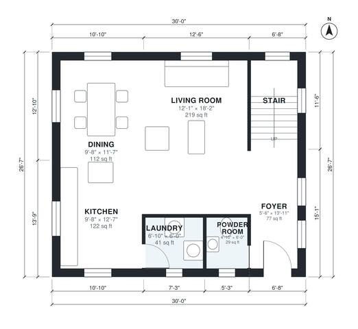

# 30 Ft Wide House Plans: 2-Story, 3 Bed, 2.5 Bath, 1,590 Sq Ft

A 30 ft wide, two-story home of about 1,600 sq ft. The ground floor is an open kitchen, dining and living area with a powder room, laundry and a stair at the entry. Upstairs, a hall serves three bedrooms and two baths, and the primary suite has its own ensuite and walk-in closet.

| | |
|---|---|
| Levels | 2 |
| Footprint | 9.14 m × 8.1 m (30 ft × 27 ft) |
| Rooms | 15 indoor, 0 outdoor |
| Indoor area including garage, from the room grid | about 148 m² (1,594 sq ft) |

## Files here

- `area-schedule.csv` (room schedule)
- `building.json` (rooms, walls, openings as data)
- `plan-level1.dxf` (floor plan, DXF, drawing units: inches)
- `plan-level2.dxf` (floor plan, DXF, drawing units: inches)

## More for this plan

- Plan page with the PDF plan set, IFC and 3D model, and a tool to change the plan: https://floorplan.ai-architectures.com/house-plans/30-ft-wide-house-plans?utm_source=github-plans&utm_medium=probe&utm_campaign=github
- PDF plan set: https://storage.googleapis.com/20img/house-plans/30-ft-wide-house-plans/plan-set.pdf
- IFC model: https://storage.googleapis.com/20img/house-plans/30-ft-wide-house-plans/model.ifc

## Known issues in this drawing

- Primary Ensuite is 5.1 m² (asked for about 7.0 m²).

Concept design generated with AI. Not for construction or permit; verify with a licensed professional.
