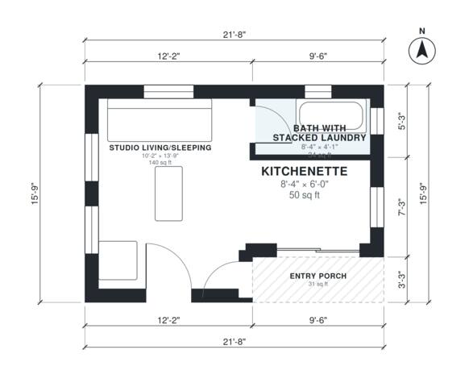

# 300 Sq Ft ADU Plans: 310 Sq Ft Studio Backyard Cottage

A compact detached studio ADU with a single combined living and sleeping room, an open kitchenette, a full bath with stacked laundry, and a small covered entry porch. After enlarging the footprint slightly to about 7.2 x 5.0 m, the interior comes to roughly 300 sq ft of conditioned space plus the porch. Daylight comes from windows on three sides, and the layout stays simple with one door to the bath and an open kitchenette.

| | |
|---|---|
| Levels | 1 |
| Footprint | 6.6 m × 4.8 m (22 ft × 16 ft) |
| Rooms | 3 indoor, 1 outdoor |
| Indoor area including garage, from the room grid | about 29 m² (310 sq ft) |

## Files here

- `area-schedule.csv` (room schedule)
- `building.json` (rooms, walls, openings as data)
- `plan-level1.dxf` (floor plan, DXF, drawing units: inches)

## More for this plan

- Plan page with the PDF plan set, IFC and 3D model, and a tool to change the plan: https://floorplan.ai-architectures.com/house-plans/300-sq-ft-adu-plans?utm_source=github-plans&utm_medium=probe&utm_campaign=github
- PDF plan set: https://storage.googleapis.com/20img/house-plans/300-sq-ft-adu-plans/plan-set.pdf
- IFC model: https://storage.googleapis.com/20img/house-plans/300-sq-ft-adu-plans/model.ifc

## Known issues in this drawing

- Studio Living/Sleeping is only 3.10 m wide.
- Bath with Stacked Laundry is 3.1 m² (asked for about 5.5 m²).
- Bath with Stacked Laundry is only 1.24 m wide.

Concept design generated with AI. Not for construction or permit; verify with a licensed professional.
