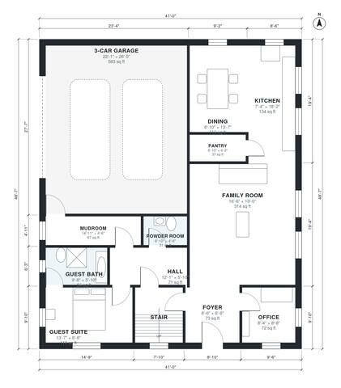

# 3000 Sq Ft 4 Bedroom House Plans: Two-Story, 3-Car Garage

This two-story modern farmhouse has about 274 m² (roughly 2,950 sq ft) of living space plus a 3-car garage. The ground floor has an open kitchen, dining and family room, an office, a pantry and a guest suite with its own bath. Upstairs are the primary suite with bath and walk-in closet, two bedrooms, a hall bath, a laundry and a large bonus room.

| | |
|---|---|
| Levels | 2 |
| Footprint | 12.5 m × 14.8 m (41 ft × 49 ft) |
| Rooms | 23 indoor, 1 outdoor |
| Indoor area including garage, from the room grid | about 332 m² (3,579 sq ft) |

## Files here

- `area-schedule.csv` (room schedule)
- `building.json` (rooms, walls, openings as data)
- `plan-level1.dxf` (floor plan, DXF, drawing units: inches)
- `plan-level2.dxf` (floor plan, DXF, drawing units: inches)

## More for this plan

- Plan page with the PDF plan set, IFC and 3D model, and a tool to change the plan: https://floorplan.ai-architectures.com/house-plans/3000-sq-ft-4-bedroom-house-plans?utm_source=github-plans&utm_medium=probe&utm_campaign=github
- PDF plan set: https://storage.googleapis.com/20img/house-plans/3000-sq-ft-4-bedroom-house-plans/plan-set.pdf
- IFC model: https://storage.googleapis.com/20img/house-plans/3000-sq-ft-4-bedroom-house-plans/model.ifc

## Known issues in this drawing

- Mudroom and Kitchen are not directly connected.
- Office is 6.7 m² (asked for about 10.0 m²).
- Bedroom 3 is only 2.44 m wide.

Concept design generated with AI. Not for construction or permit; verify with a licensed professional.
