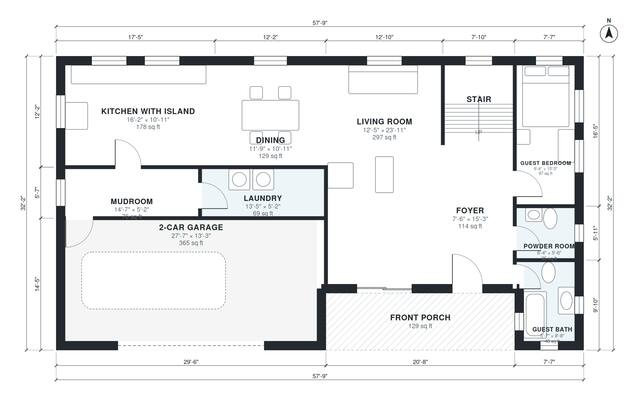

# 3000 Sq Ft 5 Bedroom House Plans: Two-Story with Loft

A two-story, five-bedroom home of about 280 m² (3,000 sq ft) of living space, plus a 2-car garage. The ground floor has an open kitchen, dining and living area, a guest bedroom with bath, a powder room, and a mudroom and laundry off the garage. Upstairs, the primary suite and three bedrooms open off a central hall, next to a family loft and a shared bath.

| | |
|---|---|
| Levels | 2 |
| Footprint | 17.6 m × 9.8 m (58 ft × 32 ft) |
| Rooms | 21 indoor, 2 outdoor |
| Indoor area including garage, from the room grid | about 308 m² (3,317 sq ft) |

## Files here

- `area-schedule.csv` (room schedule)
- `building.json` (rooms, walls, openings as data)
- `plan-level1.dxf` (floor plan, DXF, drawing units: inches)
- `plan-level2.dxf` (floor plan, DXF, drawing units: inches)

## More for this plan

- Plan page with the PDF plan set, IFC and 3D model, and a tool to change the plan: https://floorplan.ai-architectures.com/house-plans/3000-sq-ft-5-bedroom-house-plans?utm_source=github-plans&utm_medium=probe&utm_campaign=github
- PDF plan set: https://storage.googleapis.com/20img/house-plans/3000-sq-ft-5-bedroom-house-plans/plan-set.pdf
- IFC model: https://storage.googleapis.com/20img/house-plans/3000-sq-ft-5-bedroom-house-plans/model.ifc

## Known issues in this drawing

- Guest Bath is 4.5 m² (asked for about 6.5 m²).
- Guest Bedroom is only 1.94 m wide.
- Bedroom 4 is only 2.30 m wide.
- Walk-in Closet is 4.9 m² (asked for about 8.0 m²).

Concept design generated with AI. Not for construction or permit; verify with a licensed professional.
