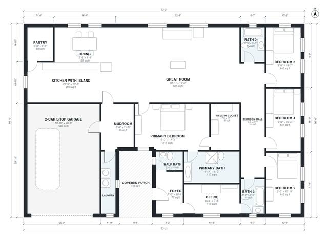

# 3000 Sq Ft Barndominium Floor Plans: 4 Bed, 3.5 Bath

This single-story barndominium is about 3,000 sq ft of living space (roughly 273 m² of rooms) plus a 600 sq ft attached 2-car shop garage and a covered front porch. The center is an open great room, kitchen with island and dining area, with a pantry, laundry and mudroom between the kitchen and the shop. The primary suite with a walk-in closet is at the west end, and three bedrooms with two baths line the east side. An office and half bath sit off the foyer.

| | |
|---|---|
| Levels | 1 |
| Footprint | 22.3 m × 15.4 m (73 ft × 51 ft) |
| Rooms | 19 indoor, 1 outdoor |
| Indoor area including garage, from the room grid | about 330 m² (3,548 sq ft) |

## Files here

- `area-schedule.csv` (room schedule)
- `building.json` (rooms, walls, openings as data)
- `plan-level1.dxf` (floor plan, DXF, drawing units: inches)

## More for this plan

- Plan page with the PDF plan set, IFC and 3D model, and a tool to change the plan: https://floorplan.ai-architectures.com/house-plans/3000-sq-ft-barndominium-floor-plans?utm_source=github-plans&utm_medium=probe&utm_campaign=github
- PDF plan set: https://storage.googleapis.com/20img/house-plans/3000-sq-ft-barndominium-floor-plans/plan-set.pdf
- IFC model: https://storage.googleapis.com/20img/house-plans/3000-sq-ft-barndominium-floor-plans/model.ifc

## Known issues in this drawing

- Laundry is 5.6 m² (asked for about 8.0 m²).
- Laundry is only 1.14 m wide.

Concept design generated with AI. Not for construction or permit; verify with a licensed professional.
