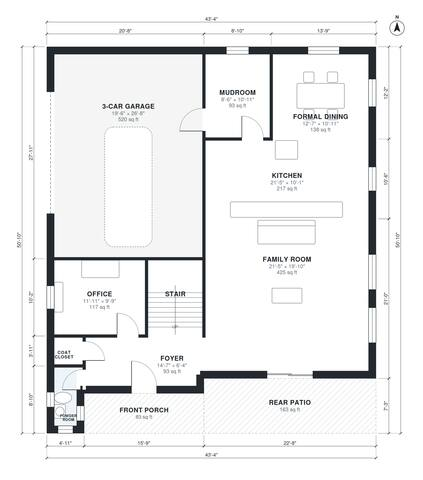

# 3000 sq ft House Plans: 4-Bedroom Two-Story with 3-Car Garage

A two-story modern farmhouse of roughly 3,000 sq ft of heated space plus a 3-car garage, porch and rear patio. The ground floor has a foyer, front office, formal dining, an open kitchen and family room opening to the patio, a powder room, and a mudroom connecting the garage to the kitchen. Upstairs are a primary suite with walk-in closet, three more bedrooms (one en suite), a hall bath, laundry and a loft.

| | |
|---|---|
| Levels | 2 |
| Footprint | 13.2 m × 15.5 m (43 ft × 51 ft) |
| Rooms | 23 indoor, 3 outdoor |
| Indoor area including garage, from the room grid | about 324 m² (3,491 sq ft) |

## Files here

- `area-schedule.csv` (room schedule)
- `building.json` (rooms, walls, openings as data)
- `plan-level1.dxf` (floor plan, DXF, drawing units: inches)
- `plan-level2.dxf` (floor plan, DXF, drawing units: inches)

## More for this plan

- Plan page with the PDF plan set, IFC and 3D model, and a tool to change the plan: https://floorplan.ai-architectures.com/house-plans/3000-sq-ft-house-plans?utm_source=github-plans&utm_medium=probe&utm_campaign=github
- PDF plan set: https://storage.googleapis.com/20img/house-plans/3000-sq-ft-house-plans/plan-set.pdf
- IFC model: https://storage.googleapis.com/20img/house-plans/3000-sq-ft-house-plans/model.ifc

## Known issues in this drawing

- Powder Room is 2.1 m² (asked for about 3.5 m²).
- Powder Room is only 0.90 m wide.
- Primary Bath is 6.9 m² (asked for about 10.0 m²).
- Bedroom 3 is only 1.94 m wide.

Concept design generated with AI. Not for construction or permit; verify with a licensed professional.
