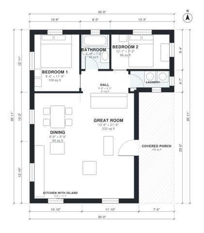

# 30x30 Barndominium Floor Plans: 2 Bed, 1 Bath, 910 Sq Ft

This compact one-story barndominium is about 900 sq ft indoors on a 30 x 30 ft footprint, with a 175 sq ft covered porch added at the front. An open great room with a kitchen island and dining area takes up the west and north of the house. A short hall on the east side serves two bedrooms, a full bath and a laundry. Windows on the exterior walls give good daylight throughout.

| | |
|---|---|
| Levels | 1 |
| Footprint | 9.14 m × 10.94 m (30 ft × 36 ft) |
| Rooms | 8 indoor, 1 outdoor |
| Indoor area including garage, from the room grid | about 84 m² (908 sq ft) |

## Files here

- `area-schedule.csv` (room schedule)
- `building.json` (rooms, walls, openings as data)
- `plan-level1.dxf` (floor plan, DXF, drawing units: inches)

## More for this plan

- Plan page with the PDF plan set, IFC and 3D model, and a tool to change the plan: https://floorplan.ai-architectures.com/house-plans/30x30-barndominium-floor-plans?utm_source=github-plans&utm_medium=probe&utm_campaign=github
- PDF plan set: https://storage.googleapis.com/20img/house-plans/30x30-barndominium-floor-plans/plan-set.pdf
- IFC model: https://storage.googleapis.com/20img/house-plans/30x30-barndominium-floor-plans/model.ifc

## Known issues in this drawing

- Laundry is 2.6 m² (asked for about 4.0 m²).
- Laundry is only 1.04 m wide.
- Bedroom 2 is only 2.18 m wide.

Concept design generated with AI. Not for construction or permit; verify with a licensed professional.
