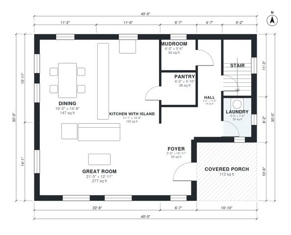

# 30x40 2 Story Barndominium Floor Plans | 3 Bed 2,290 Sq Ft

This 30 x 40 ft two-story barndominium has about 210 m² (roughly 2,260 sq ft) of living space. The ground floor has an open great room with a kitchen island, dining, pantry, laundry and mudroom, with a covered porch at the front. Upstairs are three bedrooms including a primary suite with bath and walk-in closet, a hall bath and a loft.

| | |
|---|---|
| Levels | 2 |
| Footprint | 12.19 m × 9.14 m (40 ft × 30 ft) |
| Rooms | 18 indoor, 1 outdoor |
| Indoor area including garage, from the room grid | about 212 m² (2,285 sq ft) |

## Files here

- `area-schedule.csv` (room schedule)
- `building.json` (rooms, walls, openings as data)
- `plan-level1.dxf` (floor plan, DXF, drawing units: inches)
- `plan-level2.dxf` (floor plan, DXF, drawing units: inches)

## More for this plan

- Plan page with the PDF plan set, IFC and 3D model, and a tool to change the plan: https://floorplan.ai-architectures.com/house-plans/30x40-2-story-barndominium-floor-plans?utm_source=github-plans&utm_medium=probe&utm_campaign=github
- PDF plan set: https://storage.googleapis.com/20img/house-plans/30x40-2-story-barndominium-floor-plans/plan-set.pdf
- IFC model: https://storage.googleapis.com/20img/house-plans/30x40-2-story-barndominium-floor-plans/model.ifc

## Known issues in this drawing

- Great Room is 25.8 m² (asked for about 40.0 m²).
- Mudroom is 3.2 m² (asked for about 5.0 m²).
- Laundry is 3.3 m² (asked for about 5.0 m²).
- Primary Bedroom is 14.5 m² (asked for about 24.0 m²).

Concept design generated with AI. Not for construction or permit; verify with a licensed professional.
