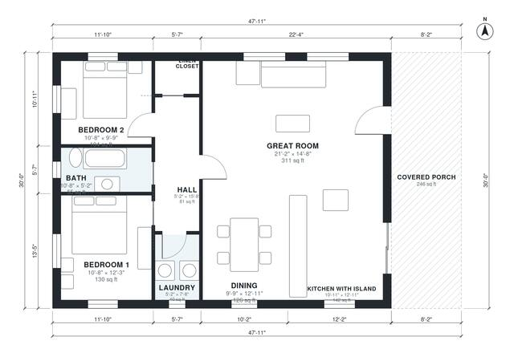

# 30x40 Barndominium Floor Plans: 2 Bed, 1 Bath, 1,190 Sq Ft

This one-story barndominium has 1,200 sq ft (about 111.5 m²) of living space in a 30 x 40 ft body, with an 8 ft deep covered porch added on the east side. The porch opens into a large great room with living, dining and a kitchen with an island. A hall on the west side leads to two bedrooms, a shared bath, a laundry and a linen closet.

| | |
|---|---|
| Levels | 1 |
| Footprint | 14.6 m × 9.14 m (48 ft × 30 ft) |
| Rooms | 9 indoor, 1 outdoor |
| Indoor area including garage, from the room grid | about 111 m² (1,190 sq ft) |

## Files here

- `area-schedule.csv` (room schedule)
- `building.json` (rooms, walls, openings as data)
- `plan-level1.dxf` (floor plan, DXF, drawing units: inches)

## More for this plan

- Plan page with the PDF plan set, IFC and 3D model, and a tool to change the plan: https://floorplan.ai-architectures.com/house-plans/30x40-barndominium-floor-plans?utm_source=github-plans&utm_medium=probe&utm_campaign=github
- PDF plan set: https://storage.googleapis.com/20img/house-plans/30x40-barndominium-floor-plans/plan-set.pdf
- IFC model: https://storage.googleapis.com/20img/house-plans/30x40-barndominium-floor-plans/model.ifc

## Known issues in this drawing

- None found by the automatic checks.

Concept design generated with AI. Not for construction or permit; verify with a licensed professional.
