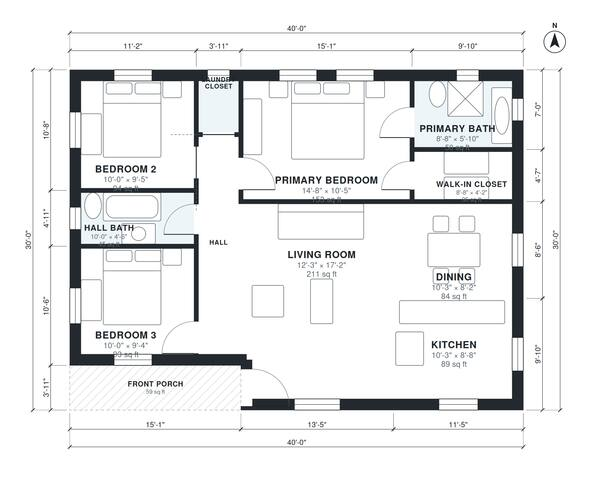

# 30x40 3 Bedroom Floor Plan: 1,140 Sq Ft One-Story, 2 Bath

This is a single-story, 3-bedroom, 2-bath farmhouse cottage on a 30 x 40 ft footprint (about 111.5 m², or 1,200 sq ft). It has an open kitchen, dining and living area, a hall that serves all three bedrooms and the hall bath, a laundry closet, and a primary suite with its own bath and walk-in closet. A covered front porch marks the entry. In the revised version the room sizes are rebalanced so they add up exactly to the footprint.

| | |
|---|---|
| Levels | 1 |
| Footprint | 12.19 m × 9.14 m (40 ft × 30 ft) |
| Rooms | 11 indoor, 1 outdoor |
| Indoor area including garage, from the room grid | about 106 m² (1,140 sq ft) |

## Files here

- `area-schedule.csv` (room schedule)
- `building.json` (rooms, walls, openings as data)
- `plan-level1.dxf` (floor plan, DXF, drawing units: inches)

## More for this plan

- Plan page with the PDF plan set, IFC and 3D model, and a tool to change the plan: https://floorplan.ai-architectures.com/house-plans/30x40-house-plans?utm_source=github-plans&utm_medium=probe&utm_campaign=github
- PDF plan set: https://storage.googleapis.com/20img/house-plans/30x40-house-plans/plan-set.pdf
- IFC model: https://storage.googleapis.com/20img/house-plans/30x40-house-plans/model.ifc

## Known issues in this drawing

- Hall Bath is only 1.38 m wide.
- Kitchen is 8.3 m² (asked for about 13.0 m²).
- Dining is only 2.48 m wide.

Concept design generated with AI. Not for construction or permit; verify with a licensed professional.
