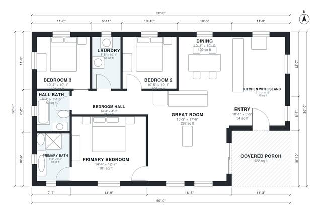

# 30x50 Barndominium Floor Plans: 3 Bed, 2 Bath, 1,380 Sq Ft

A single-story 30 x 50 ft barndominium (about 1,500 sq ft) with a covered front porch outside the rectangle. A central open great room, kitchen with island and dining area separates the primary suite on one side from two bedrooms, a hall bath and laundry on the other. The revision merges the walk-in closet into a roomier primary bedroom and trims the open-plan area slightly so the bedrooms and entry are less cramped.

| | |
|---|---|
| Levels | 1 |
| Footprint | 15.24 m × 9.14 m (50 ft × 30 ft) |
| Rooms | 11 indoor, 1 outdoor |
| Indoor area including garage, from the room grid | about 128 m² (1,377 sq ft) |

## Files here

- `area-schedule.csv` (room schedule)
- `building.json` (rooms, walls, openings as data)
- `plan-level1.dxf` (floor plan, DXF, drawing units: inches)

## More for this plan

- Plan page with the PDF plan set, IFC and 3D model, and a tool to change the plan: https://floorplan.ai-architectures.com/house-plans/30x50-barndominium-floor-plans?utm_source=github-plans&utm_medium=probe&utm_campaign=github
- PDF plan set: https://storage.googleapis.com/20img/house-plans/30x50-barndominium-floor-plans/plan-set.pdf
- IFC model: https://storage.googleapis.com/20img/house-plans/30x50-barndominium-floor-plans/model.ifc

## Known issues in this drawing

- Primary Bath is 5.5 m² (asked for about 8.0 m²).
- Primary Bath is only 1.94 m wide.
- Bedroom 3 is 9.7 m² (asked for about 13.0 m²).
- Kitchen with Island is 10.7 m² (asked for about 15.0 m²).

Concept design generated with AI. Not for construction or permit; verify with a licensed professional.
