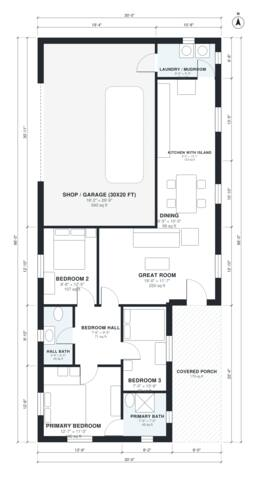

# 30x60 Barndominium Floor Plans: 3 Bed, 2 Bath, 1,200 Sq Ft

A one-story 30 x 60 ft barndominium with about 1,200 sq ft of living space (111 m²). It has an open great room, island kitchen and dining at the centre. The three bedrooms and two baths are grouped off a private hall, and a 30 x 20 ft shop is entered through the laundry/mudroom. A 30 x 6 ft covered porch sits outside the rectangle at the front door.

| | |
|---|---|
| Levels | 1 |
| Footprint | 9.14 m × 20.12 m (30 ft × 66 ft) |
| Rooms | 11 indoor, 1 outdoor |
| Indoor area including garage, from the room grid | about 167 m² (1,801 sq ft) |

## Files here

- `area-schedule.csv` (room schedule)
- `building.json` (rooms, walls, openings as data)
- `plan-level1.dxf` (floor plan, DXF, drawing units: inches)

## More for this plan

- Plan page with the PDF plan set, IFC and 3D model, and a tool to change the plan: https://floorplan.ai-architectures.com/house-plans/30x60-barndominium-floor-plans?utm_source=github-plans&utm_medium=probe&utm_campaign=github
- PDF plan set: https://storage.googleapis.com/20img/house-plans/30x60-barndominium-floor-plans/plan-set.pdf
- IFC model: https://storage.googleapis.com/20img/house-plans/30x60-barndominium-floor-plans/model.ifc

## Known issues in this drawing

- Hall Bath is only 1.44 m wide.
- Bedroom 3 is only 2.14 m wide.
- Shop / Garage (30x20 ft) is only 5.54 m wide.

Concept design generated with AI. Not for construction or permit; verify with a licensed professional.
