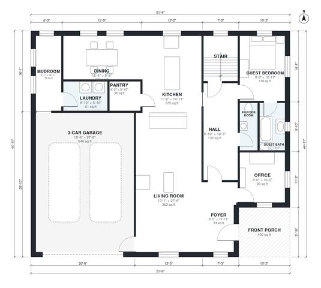

# 3200 Sq Ft House Plans: 5-Bed Two-Story with 3-Car Garage

A two-story modern farmhouse of about 290 m² (about 3,130 sq ft) of living space plus an attached 3-car garage and a front porch. The ground floor has the foyer, an open kitchen, dining and living area, an office, mudroom with laundry, and a guest suite. Upstairs are the primary suite with ensuite and walk-in closet, three more bedrooms, a hall bath and a playroom.

| | |
|---|---|
| Levels | 2 |
| Footprint | 15.7 m × 13.7 m (52 ft × 45 ft) |
| Rooms | 24 indoor, 2 outdoor |
| Indoor area including garage, from the room grid | about 347 m² (3,734 sq ft) |

## Files here

- `area-schedule.csv` (room schedule)
- `building.json` (rooms, walls, openings as data)
- `plan-level1.dxf` (floor plan, DXF, drawing units: inches)
- `plan-level2.dxf` (floor plan, DXF, drawing units: inches)

## More for this plan

- Plan page with the PDF plan set, IFC and 3D model, and a tool to change the plan: https://floorplan.ai-architectures.com/house-plans/3200-sq-ft-house-plans?utm_source=github-plans&utm_medium=probe&utm_campaign=github
- PDF plan set: https://storage.googleapis.com/20img/house-plans/3200-sq-ft-house-plans/plan-set.pdf
- IFC model: https://storage.googleapis.com/20img/house-plans/3200-sq-ft-house-plans/model.ifc

## Known issues in this drawing

- Hall and Mudroom are not directly connected.

Concept design generated with AI. Not for construction or permit; verify with a licensed professional.
