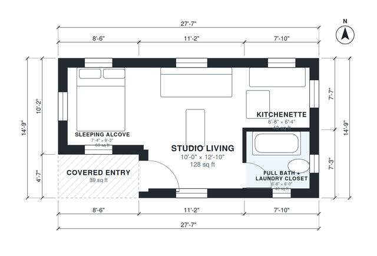

# 350 Sq Ft ADU Plans: 370 Sq Ft Detached Studio, 1 Bath

This is a compact detached backyard studio of about 34 m² (~365 sq ft) of living space, plus a covered entry porch. It has one open room for living and sleeping, with a kitchenette, a full bath that includes a laundry closet, and a sleeping alcove at one end. The plan is efficient, every room has a window, and the bath and kitchen share a wall to keep plumbing simple.

| | |
|---|---|
| Levels | 1 |
| Footprint | 8.4 m × 4.5 m (28 ft × 15 ft) |
| Rooms | 4 indoor, 1 outdoor |
| Indoor area including garage, from the room grid | about 34 m² (368 sq ft) |

## Files here

- `area-schedule.csv` (room schedule)
- `building.json` (rooms, walls, openings as data)
- `plan-level1.dxf` (floor plan, DXF, drawing units: inches)

## More for this plan

- Plan page with the PDF plan set, IFC and 3D model, and a tool to change the plan: https://floorplan.ai-architectures.com/house-plans/350-sq-ft-adu-plans?utm_source=github-plans&utm_medium=probe&utm_campaign=github
- PDF plan set: https://storage.googleapis.com/20img/house-plans/350-sq-ft-adu-plans/plan-set.pdf
- IFC model: https://storage.googleapis.com/20img/house-plans/350-sq-ft-adu-plans/model.ifc

## Known issues in this drawing

- Sleeping Alcove is 5.6 m² (asked for about 7.5 m²).
- Sleeping Alcove is only 2.24 m wide.
- Studio Living is 11.9 m² (asked for about 16.8 m²).

Concept design generated with AI. Not for construction or permit; verify with a licensed professional.
