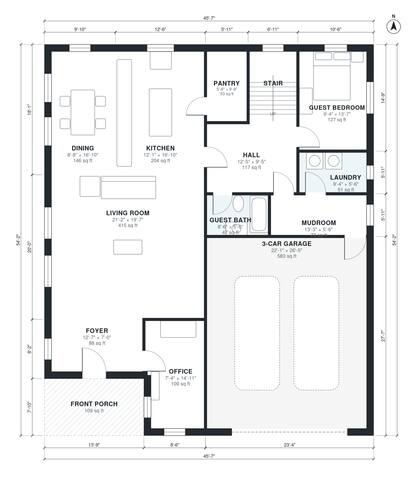

# 3500 Sq Ft House Plans: 5-Bed Two-Story with 3-Car Garage

This two-story modern farmhouse has about 340 m² (roughly 3,650 sq ft) of living space plus an attached 3-car garage. The ground floor has a large open kitchen, dining and living area, a pantry, an office, a mudroom with laundry, a front porch and a guest bedroom with a bath. Upstairs are the primary suite with a walk-in closet, three more bedrooms with two baths, and a media loft. The guest bedroom and mudroom entries are slightly indirect and can be adjusted if you want.

| | |
|---|---|
| Levels | 2 |
| Footprint | 13.9 m × 16.5 m (46 ft × 54 ft) |
| Rooms | 24 indoor, 2 outdoor |
| Indoor area including garage, from the room grid | about 394 m² (4,236 sq ft) |

## Files here

- `area-schedule.csv` (room schedule)
- `building.json` (rooms, walls, openings as data)
- `plan-level1.dxf` (floor plan, DXF, drawing units: inches)
- `plan-level2.dxf` (floor plan, DXF, drawing units: inches)

## More for this plan

- Plan page with the PDF plan set, IFC and 3D model, and a tool to change the plan: https://floorplan.ai-architectures.com/house-plans/3500-sq-ft-house-plans?utm_source=github-plans&utm_medium=probe&utm_campaign=github
- PDF plan set: https://storage.googleapis.com/20img/house-plans/3500-sq-ft-house-plans/plan-set.pdf
- IFC model: https://storage.googleapis.com/20img/house-plans/3500-sq-ft-house-plans/model.ifc

## Known issues in this drawing

- Guest Bath is 4.3 m² (asked for about 6.0 m²).

Concept design generated with AI. Not for construction or permit; verify with a licensed professional.
