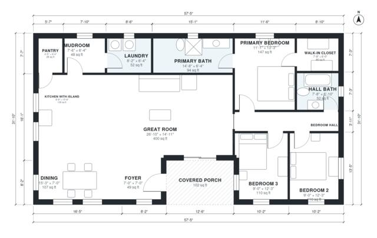

# 36x48 Barndominium Floor Plans: 3 Bed, 2 Bath, 1,720 Sq Ft

A single-storey barndominium of about 160 m² (1,728 sq ft) of living space, with a covered porch at the front corner. A large open great room, kitchen with island and dining take up the east side. The west wing holds a primary suite with walk-in closet and bath, two more bedrooms and a hall bath, all off a central hall. The mudroom, laundry and pantry sit along the north side next to the kitchen.

| | |
|---|---|
| Levels | 1 |
| Footprint | 17.5 m × 9.7 m (57 ft × 32 ft) |
| Rooms | 14 indoor, 1 outdoor |
| Indoor area including garage, from the room grid | about 160 m² (1,725 sq ft) |

## Files here

- `area-schedule.csv` (room schedule)
- `building.json` (rooms, walls, openings as data)
- `plan-level1.dxf` (floor plan, DXF, drawing units: inches)

## More for this plan

- Plan page with the PDF plan set, IFC and 3D model, and a tool to change the plan: https://floorplan.ai-architectures.com/house-plans/36x48-barndominium-floor-plans?utm_source=github-plans&utm_medium=probe&utm_campaign=github
- PDF plan set: https://storage.googleapis.com/20img/house-plans/36x48-barndominium-floor-plans/plan-set.pdf
- IFC model: https://storage.googleapis.com/20img/house-plans/36x48-barndominium-floor-plans/model.ifc

## Known issues in this drawing

- Dining is only 2.14 m wide.

Concept design generated with AI. Not for construction or permit; verify with a licensed professional.
