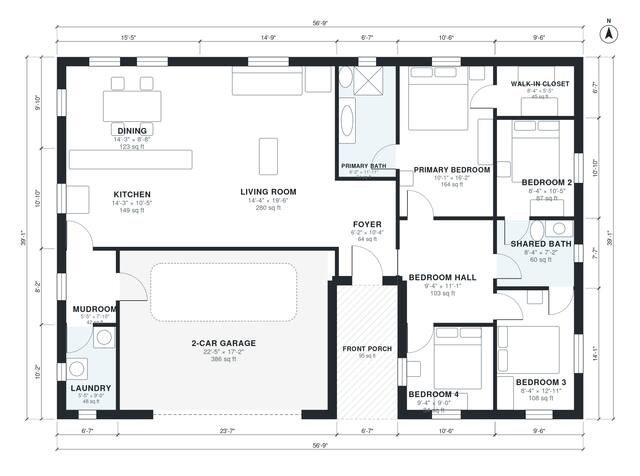

# 4 Bedroom 2 Bath House Plans: 1,690 Sq Ft Single-Story

This is a single-story ranch of about 56'-9" x 39'-1" overall, with roughly 1,750 sq ft of living space plus a 2-car garage and front porch. A large open kitchen, living and dining area sits beside the foyer. The primary suite with its bath and walk-in closet and three more bedrooms are grouped around a bedroom hall and a shared bath. The garage enters through a mudroom and laundry next to the kitchen.

| | |
|---|---|
| Levels | 1 |
| Footprint | 17.3 m × 11.9 m (57 ft × 39 ft) |
| Rooms | 15 indoor, 1 outdoor |
| Indoor area including garage, from the room grid | about 197 m² (2,121 sq ft) |

## Files here

- `area-schedule.csv` (room schedule)
- `building.json` (rooms, walls, openings as data)
- `plan-level1.dxf` (floor plan, DXF, drawing units: inches)

## More for this plan

- Plan page with the PDF plan set, IFC and 3D model, and a tool to change the plan: https://floorplan.ai-architectures.com/house-plans/4-bedroom-2-bath-house-plans?utm_source=github-plans&utm_medium=probe&utm_campaign=github
- PDF plan set: https://storage.googleapis.com/20img/house-plans/4-bedroom-2-bath-house-plans/plan-set.pdf
- IFC model: https://storage.googleapis.com/20img/house-plans/4-bedroom-2-bath-house-plans/model.ifc

## Known issues in this drawing

- Laundry is 4.5 m² (asked for about 6.0 m²).
- Bedroom 4 is 7.8 m² (asked for about 11.5 m²).
- Bedroom 2 is 8.1 m² (asked for about 12.0 m²).

Concept design generated with AI. Not for construction or permit; verify with a licensed professional.
