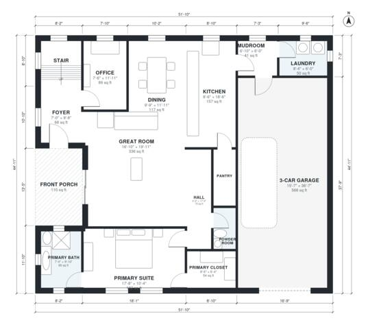

# 4 Bedroom 3.5 Bath House Plans: 2,920 Sq Ft Two-Story

This is a two-story modern farmhouse of about 3,000 sq ft of living space, plus an attached 3-car garage and a front porch. The ground floor has an open great room, kitchen and dining area, a pantry, an office, a powder room, and a primary suite with bath and walk-in closet. A mudroom and laundry link the kitchen to the garage. Upstairs are three bedrooms (one with its own bath, two sharing a bath) and a media room, all off one hall.

| | |
|---|---|
| Levels | 2 |
| Footprint | 15.8 m × 13.7 m (52 ft × 45 ft) |
| Rooms | 24 indoor, 2 outdoor |
| Indoor area including garage, from the room grid | about 330 m² (3,547 sq ft) |

## Files here

- `area-schedule.csv` (room schedule)
- `building.json` (rooms, walls, openings as data)
- `plan-level1.dxf` (floor plan, DXF, drawing units: inches)
- `plan-level2.dxf` (floor plan, DXF, drawing units: inches)

## More for this plan

- Plan page with the PDF plan set, IFC and 3D model, and a tool to change the plan: https://floorplan.ai-architectures.com/house-plans/4-bedroom-3-5-bath-house-plans?utm_source=github-plans&utm_medium=probe&utm_campaign=github
- PDF plan set: https://storage.googleapis.com/20img/house-plans/4-bedroom-3-5-bath-house-plans/plan-set.pdf
- IFC model: https://storage.googleapis.com/20img/house-plans/4-bedroom-3-5-bath-house-plans/model.ifc

## Known issues in this drawing

- Front Porch is not on the street side.
- Primary Bath is 6.4 m² (asked for about 9.0 m²).
- Bedroom 3 is only 2.14 m wide.

Concept design generated with AI. Not for construction or permit; verify with a licensed professional.
