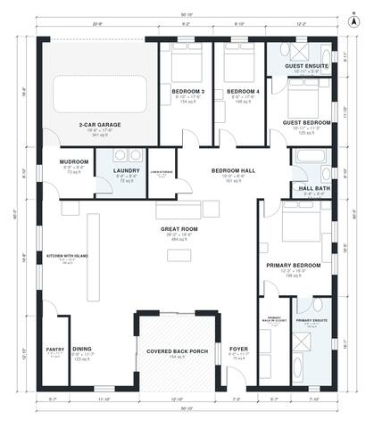

# 4 Bedroom 3 Bath Barndominium Floor Plans | 2,500 Sq Ft

This is a single-story barndominium of about 2,450 sq ft of living space, plus a 2-car garage and a covered back porch. An open great room, kitchen with island and dining area sit at the front. The primary suite, a guest suite with its own bath and two bedrooms sharing the hall bath are grouped off a central hall. The mudroom and laundry sit between the garage and the kitchen, and the porch opens from the great room and dining area.

| | |
|---|---|
| Levels | 1 |
| Footprint | 15.5 m × 18.3 m (51 ft × 60 ft) |
| Rooms | 18 indoor, 1 outdoor |
| Indoor area including garage, from the room grid | about 268 m² (2,889 sq ft) |

## Files here

- `area-schedule.csv` (room schedule)
- `building.json` (rooms, walls, openings as data)
- `plan-level1.dxf` (floor plan, DXF, drawing units: inches)

## More for this plan

- Plan page with the PDF plan set, IFC and 3D model, and a tool to change the plan: https://floorplan.ai-architectures.com/house-plans/4-bedroom-3-bath-barndominium-floor-plans?utm_source=github-plans&utm_medium=probe&utm_campaign=github
- PDF plan set: https://storage.googleapis.com/20img/house-plans/4-bedroom-3-bath-barndominium-floor-plans/plan-set.pdf
- IFC model: https://storage.googleapis.com/20img/house-plans/4-bedroom-3-bath-barndominium-floor-plans/model.ifc

## Known issues in this drawing

- None found by the automatic checks.

Concept design generated with AI. Not for construction or permit; verify with a licensed professional.
