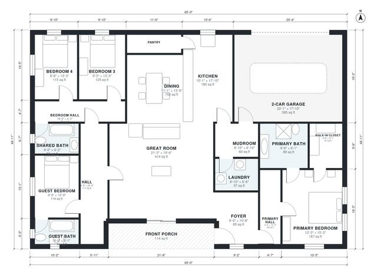

# 4 Bedroom 3 Bath House Plans: 2,360 Sq Ft Single-Story Home

This is a single-story, 4-bedroom, 3-bath modern farmhouse with about 222 m² (roughly 2,390 sq ft) of living space, not counting the garage and porch. The front porch opens to a foyer and a large open kitchen, dining and great room. The primary suite sits apart with a bath and walk-in closet. A guest bedroom with its own bath and two bedrooms sharing a bath are grouped off the hall on the other side. The 2-car garage enters through a mudroom beside the laundry and kitchen.

| | |
|---|---|
| Levels | 1 |
| Footprint | 19.8 m × 13.7 m (65 ft × 45 ft) |
| Rooms | 19 indoor, 1 outdoor |
| Indoor area including garage, from the room grid | about 261 m² (2,806 sq ft) |

## Files here

- `area-schedule.csv` (room schedule)
- `building.json` (rooms, walls, openings as data)
- `plan-level1.dxf` (floor plan, DXF, drawing units: inches)

## More for this plan

- Plan page with the PDF plan set, IFC and 3D model, and a tool to change the plan: https://floorplan.ai-architectures.com/house-plans/4-bedroom-3-bath-house-plans?utm_source=github-plans&utm_medium=probe&utm_campaign=github
- PDF plan set: https://storage.googleapis.com/20img/house-plans/4-bedroom-3-bath-house-plans/plan-set.pdf
- IFC model: https://storage.googleapis.com/20img/house-plans/4-bedroom-3-bath-house-plans/model.ifc

## Known issues in this drawing

- Dining has no window.

Concept design generated with AI. Not for construction or permit; verify with a licensed professional.
