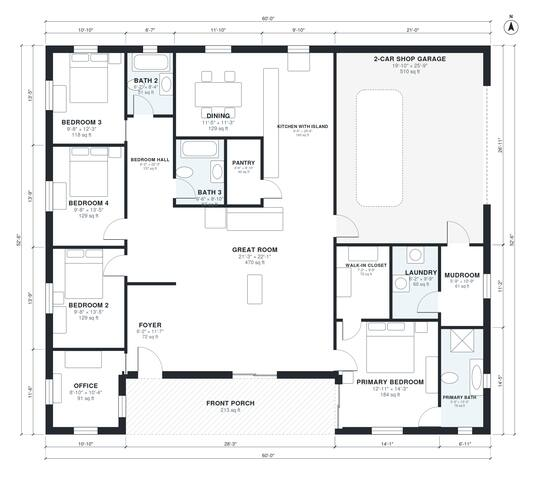

# 4 Bedroom Barndominium Floor Plans: 2,370 Sq Ft, 3 Bath

This single-story barndominium is a 22.9 x 12.8 m rectangle with about 223 m² (2,400 sq ft) of living space. It also has a front porch and an attached 2-car shop garage. The front porch leads into a foyer and a large open great room, kitchen with island and dining. The primary suite with ensuite and walk-in closet sits on one side, and three more bedrooms and two baths share a bedroom hall on the other. The office is by the entry, and the mudroom and laundry link the garage to the kitchen.

| | |
|---|---|
| Levels | 1 |
| Footprint | 18.3 m × 16.0 m (60 ft × 52 ft) |
| Rooms | 18 indoor, 1 outdoor |
| Indoor area including garage, from the room grid | about 273 m² (2,939 sq ft) |

## Files here

- `building.json` (rooms, walls, openings as data)
- `plan-level1.dxf` (floor plan, DXF, drawing units: inches)

## More for this plan

- Plan page with the PDF plan set, IFC and 3D model, and a tool to change the plan: https://floorplan.ai-architectures.com/house-plans/4-bedroom-barndominium-floor-plans?utm_source=github-plans&utm_medium=probe&utm_campaign=github
- PDF plan set: https://storage.googleapis.com/20img/house-plans/4-bedroom-barndominium-floor-plans/plan-set.pdf
- IFC model: https://storage.googleapis.com/20img/house-plans/4-bedroom-barndominium-floor-plans/model.ifc

## Known issues in this drawing

- Kitchen with Island and Mudroom are not directly connected.

Concept design generated with AI. Not for construction or permit; verify with a licensed professional.
