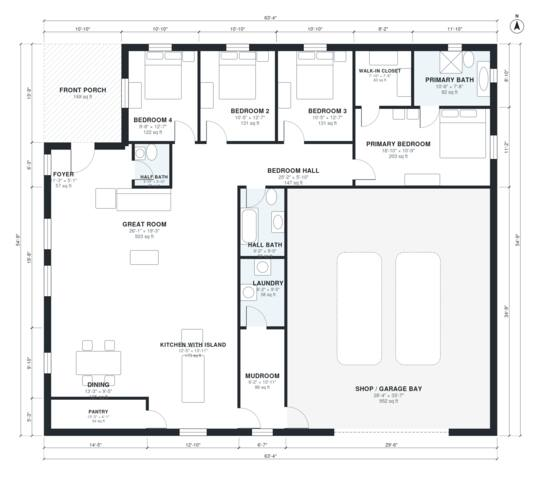

# 4 Bedroom Barndominium With Shop House Plan, 2,290 Sq Ft

This single-story barndominium has about 2,300 sq ft (214 m²) of living space plus a 95 m² attached shop and a covered front porch. The great room, island kitchen and dining form one open space. The mudroom and laundry connect it to the shop, and four bedrooms sit along a private hall, with the primary suite and walk-in closet at the far end.

| | |
|---|---|
| Levels | 1 |
| Footprint | 19.3 m × 16.7 m (63 ft × 55 ft) |
| Rooms | 17 indoor, 1 outdoor |
| Indoor area including garage, from the room grid | about 308 m² (3,320 sq ft) |

## Files here

- `area-schedule.csv` (room schedule)
- `building.json` (rooms, walls, openings as data)
- `plan-level1.dxf` (floor plan, DXF, drawing units: inches)

## More for this plan

- Plan page with the PDF plan set, IFC and 3D model, and a tool to change the plan: https://floorplan.ai-architectures.com/house-plans/4-bedroom-barndominium-with-shop?utm_source=github-plans&utm_medium=probe&utm_campaign=github
- PDF plan set: https://storage.googleapis.com/20img/house-plans/4-bedroom-barndominium-with-shop/plan-set.pdf
- IFC model: https://storage.googleapis.com/20img/house-plans/4-bedroom-barndominium-with-shop/model.ifc

## Known issues in this drawing

- Front Porch is not on the street side.

Concept design generated with AI. Not for construction or permit; verify with a licensed professional.
