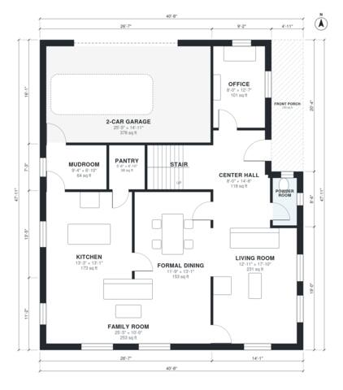

# 4 Bedroom Colonial House Plans | 2,690 Sq Ft, 2-Car Garage

This two-story center-hall colonial has about 253 m² (about 2,720 sq ft) of living space, plus a 2-car garage and a front porch. The ground floor has a center hall with the stair, a front office, a powder room, a formal living room and dining room, and a kitchen open to a large family room. A mudroom links the kitchen to the garage. Upstairs, a long hall serves four bedrooms, including a primary suite with a bath and walk-in closet, plus a hall bath and a laundry.

| | |
|---|---|
| Levels | 2 |
| Footprint | 12.4 m × 14.6 m (41 ft × 48 ft) |
| Rooms | 21 indoor, 2 outdoor |
| Indoor area including garage, from the room grid | about 290 m² (3,122 sq ft) |

## Files here

- `area-schedule.csv` (room schedule)
- `building.json` (rooms, walls, openings as data)
- `plan-level1.dxf` (floor plan, DXF, drawing units: inches)
- `plan-level2.dxf` (floor plan, DXF, drawing units: inches)

## More for this plan

- Plan page with the PDF plan set, IFC and 3D model, and a tool to change the plan: https://floorplan.ai-architectures.com/house-plans/4-bedroom-colonial-house-plans?utm_source=github-plans&utm_medium=probe&utm_campaign=github
- PDF plan set: https://storage.googleapis.com/20img/house-plans/4-bedroom-colonial-house-plans/plan-set.pdf
- IFC model: https://storage.googleapis.com/20img/house-plans/4-bedroom-colonial-house-plans/model.ifc

## Known issues in this drawing

- Front Porch is not on the street side.
- Formal Dining has no window.

Concept design generated with AI. Not for construction or permit; verify with a licensed professional.
