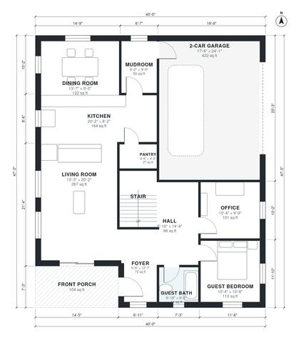

# 4 Bedroom Craftsman House Plans: 2,650 Sq Ft Two-Story

This two-story craftsman has about 245-250 m² (roughly 2,600 sq ft) of living space, plus an attached 2-car garage and a front porch. Downstairs has an open living, kitchen and dining area with a pantry, a mudroom linking the garage to the kitchen, a guest bedroom with bath, and an office. Upstairs has a primary suite with an ensuite bath and walk-in closet, two more bedrooms, a hall bath, a laundry room and a loft.

| | |
|---|---|
| Levels | 2 |
| Footprint | 12.2 m × 14.4 m (40 ft × 47 ft) |
| Rooms | 22 indoor, 2 outdoor |
| Indoor area including garage, from the room grid | about 290 m² (3,126 sq ft) |

## Files here

- `area-schedule.csv` (room schedule)
- `building.json` (rooms, walls, openings as data)
- `plan-level1.dxf` (floor plan, DXF, drawing units: inches)
- `plan-level2.dxf` (floor plan, DXF, drawing units: inches)

## More for this plan

- Plan page with the PDF plan set, IFC and 3D model, and a tool to change the plan: https://floorplan.ai-architectures.com/house-plans/4-bedroom-craftsman-house-plans?utm_source=github-plans&utm_medium=probe&utm_campaign=github
- PDF plan set: https://storage.googleapis.com/20img/house-plans/4-bedroom-craftsman-house-plans/plan-set.pdf
- IFC model: https://storage.googleapis.com/20img/house-plans/4-bedroom-craftsman-house-plans/model.ifc

## Known issues in this drawing

- None found by the automatic checks.

Concept design generated with AI. Not for construction or permit; verify with a licensed professional.
