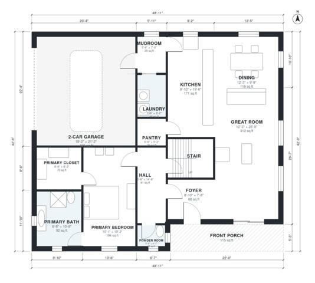

# 4 Bedroom Farmhouse Plans: 2,910 Sq Ft Two-Story Design

A two-story modern farmhouse of about 275 m² (roughly 2,950 sq ft) of living space, plus a 2-car garage. The ground floor has an open kitchen, dining and great room, a primary suite with bath and walk-in closet, a mudroom and laundry beside the garage, and a front porch. Upstairs are three bedrooms, two baths and a generous bonus room. The revision fills the upper floor properly and enlarges the entry and pantry.

| | |
|---|---|
| Levels | 2 |
| Footprint | 14.9 m × 13.0 m (49 ft × 43 ft) |
| Rooms | 23 indoor, 2 outdoor |
| Indoor area including garage, from the room grid | about 313 m² (3,365 sq ft) |

## Files here

- `area-schedule.csv` (room schedule)
- `building.json` (rooms, walls, openings as data)
- `plan-level1.dxf` (floor plan, DXF, drawing units: inches)
- `plan-level2.dxf` (floor plan, DXF, drawing units: inches)

## More for this plan

- Plan page with the PDF plan set, IFC and 3D model, and a tool to change the plan: https://floorplan.ai-architectures.com/house-plans/4-bedroom-farmhouse-plans?utm_source=github-plans&utm_medium=probe&utm_campaign=github
- PDF plan set: https://storage.googleapis.com/20img/house-plans/4-bedroom-farmhouse-plans/plan-set.pdf
- IFC model: https://storage.googleapis.com/20img/house-plans/4-bedroom-farmhouse-plans/model.ifc

## Known issues in this drawing

- Powder Room is 2.0 m² (asked for about 3.0 m²).
- Mudroom is 3.6 m² (asked for about 6.0 m²).
- Bedroom 3 is 10.2 m² (asked for about 15.0 m²).
- Bedroom 3 is only 2.04 m wide.
- Hall Bath is 3.2 m² (asked for about 6.0 m²).

Concept design generated with AI. Not for construction or permit; verify with a licensed professional.
