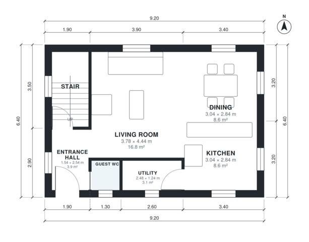

# 4 Bedroom House Plan 115 M2: Two-Story, 1,270 Sq Ft Home

A compact two-storey home of about 115 m² (roughly 58 m² per floor, garage excluded). The ground floor has an open kitchen, dining and living area, a guest WC, a utility room and an entrance hall. Upstairs, four compact bedrooms, a bathroom and a shower room open off a central hall. The footprint is being made more square so the kitchen, dining room and bedrooms are less narrow.

| | |
|---|---|
| Levels | 2 |
| Footprint | 9.2 m × 6.4 m (30 ft × 21 ft) |
| Rooms | 15 indoor, 0 outdoor |
| Indoor area including garage, from the room grid | about 118 m² (1,268 sq ft) |

## Files here

- `area-schedule.csv` (room schedule)
- `building.json` (rooms, walls, openings as data)
- `plan-level1.dxf` (floor plan, DXF, drawing units: millimetres)
- `plan-level2.dxf` (floor plan, DXF, drawing units: millimetres)

## More for this plan

- Plan page with the PDF plan set, IFC and 3D model, and a tool to change the plan: https://floorplan.ai-architectures.com/house-plans/4-bedroom-house-plan-115-m2?utm_source=github-plans&utm_medium=probe&utm_campaign=github
- PDF plan set: https://storage.googleapis.com/20img/house-plans/4-bedroom-house-plan-115-m2/plan-set.pdf
- IFC model: https://storage.googleapis.com/20img/house-plans/4-bedroom-house-plan-115-m2/model.ifc

## Known issues in this drawing

- Upper Hall and Bedroom 2 are not directly connected.
- Bedroom 2 is only reachable through another bedroom.
- Bedroom 1 is only 2.64 m wide.

Concept design generated with AI. Not for construction or permit; verify with a licensed professional.
