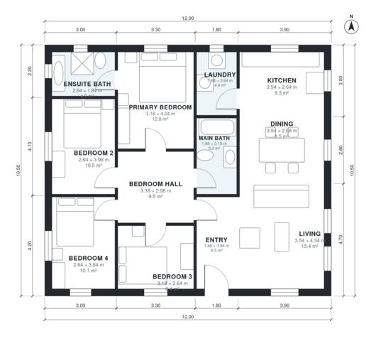

# 4 Bedroom House Plan 125 m2: 1,360 Sq Ft Single-Story Home

A compact single-storey home of about 126 m² (about 1,356 sq ft) with an open kitchen, dining and living area at the front. Four bedrooms and the main bath open off one central hall, and the primary bedroom has its own ensuite. A laundry room sits next to the kitchen, and there is no garage or basement.

| | |
|---|---|
| Levels | 1 |
| Footprint | 12.0 m × 10.5 m (39 ft × 34 ft) |
| Rooms | 12 indoor, 0 outdoor |
| Indoor area including garage, from the room grid | about 126 m² (1,356 sq ft) |

## Files here

- `area-schedule.csv` (room schedule)
- `building.json` (rooms, walls, openings as data)
- `plan-level1.dxf` (floor plan, DXF, drawing units: millimetres)

## More for this plan

- Plan page with the PDF plan set, IFC and 3D model, and a tool to change the plan: https://floorplan.ai-architectures.com/house-plans/4-bedroom-house-plan-125-m2?utm_source=github-plans&utm_medium=probe&utm_campaign=github
- PDF plan set: https://storage.googleapis.com/20img/house-plans/4-bedroom-house-plan-125-m2/plan-set.pdf
- IFC model: https://storage.googleapis.com/20img/house-plans/4-bedroom-house-plan-125-m2/model.ifc

## Known issues in this drawing

- Living is 15.4 m² (asked for about 21.5 m²).

Concept design generated with AI. Not for construction or permit; verify with a licensed professional.
