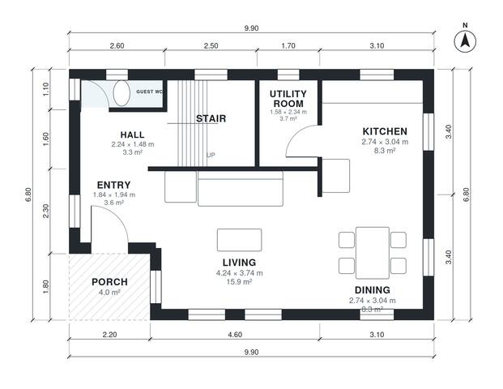

# 4 Bedroom House Plan 135 m2: 1,410 Sq Ft Two-Story Layout

This is a compact two-storey home of about 135 m², with roughly 67 m² on each floor. The ground floor has an open kitchen, dining and living area, a guest WC, a utility room and a covered porch entry. Upstairs, four bedrooms, a family bath and a primary ensuite all open off a central landing. The revision uses a squarer footprint so the bedrooms are better proportioned.

| | |
|---|---|
| Levels | 2 |
| Footprint | 9.9 m × 6.8 m (32 ft × 22 ft) |
| Rooms | 16 indoor, 1 outdoor |
| Indoor area including garage, from the room grid | about 131 m² (1,407 sq ft) |

## Files here

- `area-schedule.csv` (room schedule)
- `building.json` (rooms, walls, openings as data)
- `plan-level1.dxf` (floor plan, DXF, drawing units: millimetres)
- `plan-level2.dxf` (floor plan, DXF, drawing units: millimetres)

## More for this plan

- Plan page with the PDF plan set, IFC and 3D model, and a tool to change the plan: https://floorplan.ai-architectures.com/house-plans/4-bedroom-house-plan-135-m2?utm_source=github-plans&utm_medium=probe&utm_campaign=github
- PDF plan set: https://storage.googleapis.com/20img/house-plans/4-bedroom-house-plan-135-m2/plan-set.pdf
- IFC model: https://storage.googleapis.com/20img/house-plans/4-bedroom-house-plan-135-m2/model.ifc

## Known issues in this drawing

- Entry is 3.6 m² (asked for about 5.0 m²).
- Bedroom 4 is 5.9 m² (asked for about 9.5 m²).
- Bedroom 4 is only 2.34 m wide.

Concept design generated with AI. Not for construction or permit; verify with a licensed professional.
