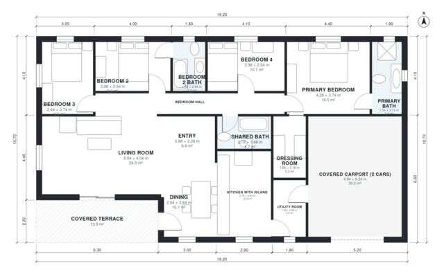

# 4 Bedroom House Plan 155 m2 | 1,690 Sq Ft, 3 Baths, 1 Story

This is a compact single-storey home with about 158 m² (1,700 sq ft) of living space, plus a 30 m² covered 2-car carport and a 13 m² covered terrace. The open kitchen with island, dining and living area opens onto the terrace. A separate bedroom wing holds the primary suite with dressing room and ensuite, plus three more bedrooms and two further baths. The utility room links the carport to the kitchen.

| | |
|---|---|
| Levels | 1 |
| Footprint | 19.2 m × 10.7 m (63 ft × 35 ft) |
| Rooms | 15 indoor, 1 outdoor |
| Indoor area including garage, from the room grid | about 192 m² (2,062 sq ft) |

## Files here

- `area-schedule.csv` (room schedule)
- `building.json` (rooms, walls, openings as data)
- `plan-level1.dxf` (floor plan, DXF, drawing units: millimetres)

## More for this plan

- Plan page with the PDF plan set, IFC and 3D model, and a tool to change the plan: https://floorplan.ai-architectures.com/house-plans/4-bedroom-house-plan-155-m2?utm_source=github-plans&utm_medium=probe&utm_campaign=github
- PDF plan set: https://storage.googleapis.com/20img/house-plans/4-bedroom-house-plan-155-m2/plan-set.pdf
- IFC model: https://storage.googleapis.com/20img/house-plans/4-bedroom-house-plan-155-m2/model.ifc

## Known issues in this drawing

- None found by the automatic checks.

Concept design generated with AI. Not for construction or permit; verify with a licensed professional.
