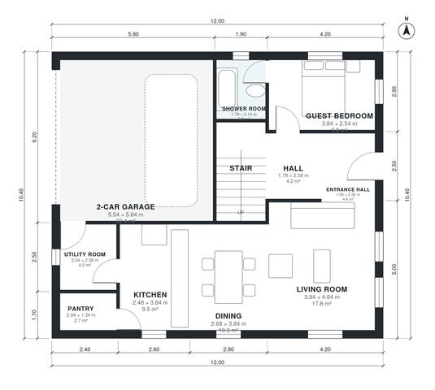

# 4 Bedroom House Plan 165 m2: 2-Story with 2-Car Garage

This compact two-storey house has about 165 m² of living space plus an attached 2-car garage. The ground floor has an open living, dining and kitchen area with a pantry, a utility room that connects to the garage, and a guest bedroom with its own shower room. Upstairs are the primary suite with ensuite and walk-in closet, two further bedrooms and a family bath, all off a central landing.

| | |
|---|---|
| Levels | 2 |
| Footprint | 12.0 m × 10.4 m (39 ft × 34 ft) |
| Rooms | 19 indoor, 1 outdoor |
| Indoor area including garage, from the room grid | about 205 m² (2,210 sq ft) |

## Files here

- `area-schedule.csv` (room schedule)
- `building.json` (rooms, walls, openings as data)
- `plan-level1.dxf` (floor plan, DXF, drawing units: millimetres)
- `plan-level2.dxf` (floor plan, DXF, drawing units: millimetres)

## More for this plan

- Plan page with the PDF plan set, IFC and 3D model, and a tool to change the plan: https://floorplan.ai-architectures.com/house-plans/4-bedroom-house-plan-165-m2?utm_source=github-plans&utm_medium=probe&utm_campaign=github
- PDF plan set: https://storage.googleapis.com/20img/house-plans/4-bedroom-house-plan-165-m2/plan-set.pdf
- IFC model: https://storage.googleapis.com/20img/house-plans/4-bedroom-house-plan-165-m2/model.ifc

## Known issues in this drawing

- Landing Hall and Primary Bedroom are not directly connected.
- Bedroom 3 is only 2.30 m wide.
- Walk-in Closet is 3.3 m² (asked for about 5.0 m²).

Concept design generated with AI. Not for construction or permit; verify with a licensed professional.
