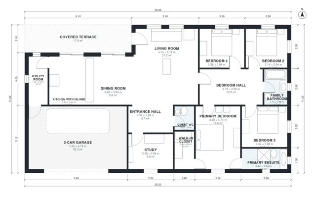

# 4 Bedroom House Plan 175 m2: Single-Story, 2-Car Garage

A single-storey, 4-bedroom house of about 172 m² of living space, plus a 38 m² double garage and a 16 m² covered terrace. The open kitchen, dining and living area opens onto the terrace. The primary suite with ensuite and walk-in closet sits in a bedroom wing with three more bedrooms and a family bath. The revision adds a covered front porch for a proper entry and widens the kitchen and dining.

| | |
|---|---|
| Levels | 1 |
| Footprint | 20.2 m × 11.2 m (66 ft × 37 ft) |
| Rooms | 16 indoor, 1 outdoor |
| Indoor area including garage, from the room grid | about 209 m² (2,252 sq ft) |

## Files here

- `area-schedule.csv` (room schedule)
- `building.json` (rooms, walls, openings as data)
- `plan-level1.dxf` (floor plan, DXF, drawing units: millimetres)

## More for this plan

- Plan page with the PDF plan set, IFC and 3D model, and a tool to change the plan: https://floorplan.ai-architectures.com/house-plans/4-bedroom-house-plan-175-m2?utm_source=github-plans&utm_medium=probe&utm_campaign=github
- PDF plan set: https://storage.googleapis.com/20img/house-plans/4-bedroom-house-plan-175-m2/plan-set.pdf
- IFC model: https://storage.googleapis.com/20img/house-plans/4-bedroom-house-plan-175-m2/model.ifc

## Known issues in this drawing

- None found by the automatic checks.

Concept design generated with AI. Not for construction or permit; verify with a licensed professional.
