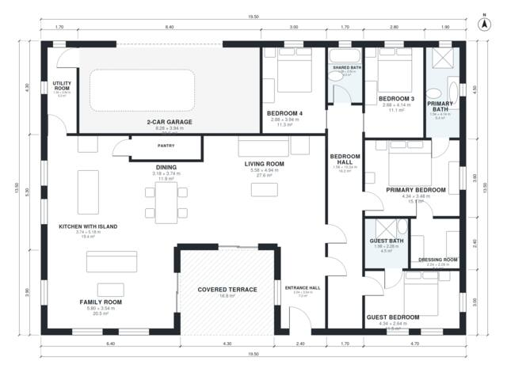

# 4 Bedroom House Plan 210 m2: 2,260 Sq Ft Single-Story Home

A single-storey 4-bedroom, 3-bath home on a 19.5 x 13.5 m footprint, with about 210 m² of living space plus a 2-car garage and covered terrace. The open kitchen with island, pantry, dining, living and family room form one social zone. The primary suite with dressing room, the guest suite and two more bedrooms are grouped along a private bedroom hall.

| | |
|---|---|
| Levels | 1 |
| Footprint | 19.5 m × 13.5 m (64 ft × 44 ft) |
| Rooms | 17 indoor, 1 outdoor |
| Indoor area including garage, from the room grid | about 246 m² (2,653 sq ft) |

## Files here

- `area-schedule.csv` (room schedule)
- `building.json` (rooms, walls, openings as data)
- `plan-level1.dxf` (floor plan, DXF, drawing units: millimetres)

## More for this plan

- Plan page with the PDF plan set, IFC and 3D model, and a tool to change the plan: https://floorplan.ai-architectures.com/house-plans/4-bedroom-house-plan-210-m2?utm_source=github-plans&utm_medium=probe&utm_campaign=github
- PDF plan set: https://storage.googleapis.com/20img/house-plans/4-bedroom-house-plan-210-m2/plan-set.pdf
- IFC model: https://storage.googleapis.com/20img/house-plans/4-bedroom-house-plan-210-m2/model.ifc

## Known issues in this drawing

- Dining has no window.

Concept design generated with AI. Not for construction or permit; verify with a licensed professional.
