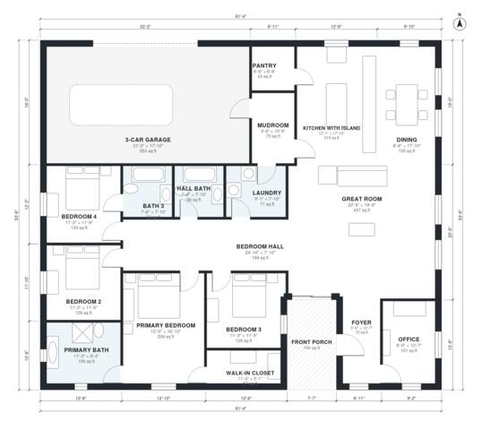

# 4 Bedroom House Plans With 3 Car Garage: 2,570 Sq Ft Ranch

This is a single-story, 4-bedroom, 3-bath modern farmhouse of about 240 m² (2,600 sq ft) of living space, plus a 3-car garage and a front porch. The open kitchen with island, dining and great room sit at the center. The primary suite and three bedrooms are in a quiet wing off a hall. The mudroom, laundry and pantry sit between the garage and kitchen, and the office is off the foyer at the front.

| | |
|---|---|
| Levels | 1 |
| Footprint | 18.7 m × 16.3 m (61 ft × 53 ft) |
| Rooms | 18 indoor, 1 outdoor |
| Indoor area including garage, from the room grid | about 295 m² (3,177 sq ft) |

## Files here

- `area-schedule.csv` (room schedule)
- `building.json` (rooms, walls, openings as data)
- `plan-level1.dxf` (floor plan, DXF, drawing units: inches)

## More for this plan

- Plan page with the PDF plan set, IFC and 3D model, and a tool to change the plan: https://floorplan.ai-architectures.com/house-plans/4-bedroom-house-plans-with-3-car-garage?utm_source=github-plans&utm_medium=probe&utm_campaign=github
- PDF plan set: https://storage.googleapis.com/20img/house-plans/4-bedroom-house-plans-with-3-car-garage/plan-set.pdf
- IFC model: https://storage.googleapis.com/20img/house-plans/4-bedroom-house-plans-with-3-car-garage/model.ifc

## Known issues in this drawing

- Foyer is 6.7 m² (asked for about 9.0 m²).

Concept design generated with AI. Not for construction or permit; verify with a licensed professional.
