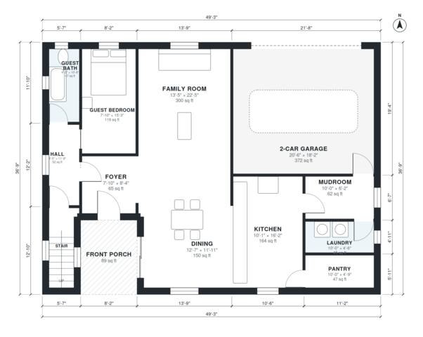

# 4 Bedroom House Plans with Bonus Room: 2,850 Sq Ft Two-Story

This is a two-story, 4-bedroom, 3-bath modern farmhouse with about 253 m² (roughly 2,700 sq ft) of living space. It also has a 40 m² two-car garage and a front porch. The ground floor has an open kitchen, dining and family room, a guest bedroom and bath, and a mudroom and laundry between the garage and kitchen. Upstairs are the primary suite with a walk-in closet, two bedrooms, a hall bath and a large bonus room over the garage.

| | |
|---|---|
| Levels | 2 |
| Footprint | 15.0 m × 11.2 m (49 ft × 37 ft) |
| Rooms | 21 indoor, 2 outdoor |
| Indoor area including garage, from the room grid | about 304 m² (3,268 sq ft) |

## Files here

- `area-schedule.csv` (room schedule)
- `building.json` (rooms, walls, openings as data)
- `plan-level1.dxf` (floor plan, DXF, drawing units: inches)
- `plan-level2.dxf` (floor plan, DXF, drawing units: inches)

## More for this plan

- Plan page with the PDF plan set, IFC and 3D model, and a tool to change the plan: https://floorplan.ai-architectures.com/house-plans/4-bedroom-house-plans-with-bonus-room?utm_source=github-plans&utm_medium=probe&utm_campaign=github
- PDF plan set: https://storage.googleapis.com/20img/house-plans/4-bedroom-house-plans-with-bonus-room/plan-set.pdf
- IFC model: https://storage.googleapis.com/20img/house-plans/4-bedroom-house-plans-with-bonus-room/model.ifc

## Known issues in this drawing

- Guest Bath is only 1.34 m wide.
- Guest Bedroom is only 2.38 m wide.

Concept design generated with AI. Not for construction or permit; verify with a licensed professional.
