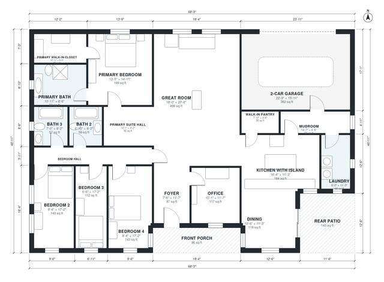

# 4 Bedroom House Plans: Single-Story 2,550 Sq Ft Design

This is a single-story modern farmhouse of about 2,500 sq ft heated, with a garage, porch and patio on top of that. It has an open great room, kitchen with island and dining area, a front office, and a private primary suite with bath and walk-in closet. Three more bedrooms share a hall with two full baths, and the mudroom, laundry and pantry sit between the garage and kitchen.

| | |
|---|---|
| Levels | 1 |
| Footprint | 20.8 m × 14.3 m (68 ft × 47 ft) |
| Rooms | 19 indoor, 2 outdoor |
| Indoor area including garage, from the room grid | about 275 m² (2,962 sq ft) |

## Files here

- `area-schedule.csv` (room schedule)
- `building.json` (rooms, walls, openings as data)
- `plan-level1.dxf` (floor plan, DXF, drawing units: inches)

## More for this plan

- Plan page with the PDF plan set, IFC and 3D model, and a tool to change the plan: https://floorplan.ai-architectures.com/house-plans/4-bedroom-house-plans?utm_source=github-plans&utm_medium=probe&utm_campaign=github
- PDF plan set: https://storage.googleapis.com/20img/house-plans/4-bedroom-house-plans/plan-set.pdf
- IFC model: https://storage.googleapis.com/20img/house-plans/4-bedroom-house-plans/model.ifc

## Known issues in this drawing

- Bedroom 3 is only 1.98 m wide.
- Dining is 11.0 m² (asked for about 15.0 m²).
- Kitchen with Island is only 3.44 m wide.
- 2-Car Garage is only 4.84 m wide.

Concept design generated with AI. Not for construction or permit; verify with a licensed professional.
