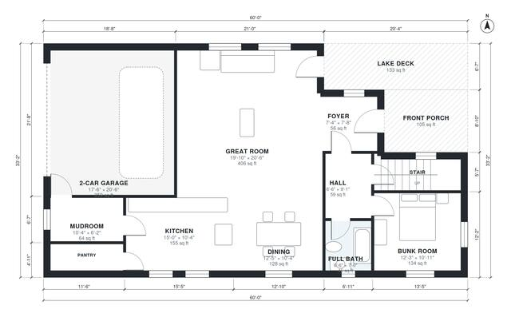

# 4 Bedroom Lake House Plans: 2,730 Sq Ft, 2-Story, 3 Bath

A two-story lake house of about 245 m² (about 2,640 sq ft) of living space, plus a 2-car garage, front porch and lake deck. The ground floor has an open great room, kitchen and dining area facing the lake, with a bunk room, full bath, mudroom and laundry. Upstairs are the primary suite with walk-in closet, two bedrooms, a hall bath and a loft that opens onto a new lake-view balcony.

| | |
|---|---|
| Levels | 2 |
| Footprint | 18.3 m × 10.1 m (60 ft × 33 ft) |
| Rooms | 21 indoor, 3 outdoor |
| Indoor area including garage, from the room grid | about 291 m² (3,135 sq ft) |

## Files here

- `area-schedule.csv` (room schedule)
- `building.json` (rooms, walls, openings as data)
- `plan-level1.dxf` (floor plan, DXF, drawing units: inches)
- `plan-level2.dxf` (floor plan, DXF, drawing units: inches)

## More for this plan

- Plan page with the PDF plan set, IFC and 3D model, and a tool to change the plan: https://floorplan.ai-architectures.com/house-plans/4-bedroom-lake-house-plans?utm_source=github-plans&utm_medium=probe&utm_campaign=github
- PDF plan set: https://storage.googleapis.com/20img/house-plans/4-bedroom-lake-house-plans/plan-set.pdf
- IFC model: https://storage.googleapis.com/20img/house-plans/4-bedroom-lake-house-plans/model.ifc

## Known issues in this drawing

- Front Porch is not on the street side.
- Foyer is 5.2 m² (asked for about 7.0 m²).
- Primary Bedroom is only 2.80 m wide.

Concept design generated with AI. Not for construction or permit; verify with a licensed professional.
