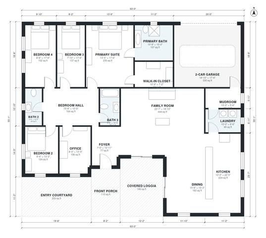

# 4 Bedroom Mediterranean House Plans: 2,570 Sq Ft, 3 Bath

This single-story Mediterranean home has about 240 m² (2,600 sq ft) of living space, plus a 2-car garage, a front porch, an entry courtyard and a covered loggia. You enter through the courtyard and porch into a foyer. From there you reach a large open kitchen, family room and dining area that connects to the loggia. A separate bedroom wing holds four bedrooms, three baths and an office, and the primary suite has its own bath and walk-in closet.

| | |
|---|---|
| Levels | 1 |
| Footprint | 19.2 m × 16.8 m (63 ft × 55 ft) |
| Rooms | 17 indoor, 3 outdoor |
| Indoor area including garage, from the room grid | about 273 m² (2,943 sq ft) |

## Files here

- `area-schedule.csv` (room schedule)
- `building.json` (rooms, walls, openings as data)
- `plan-level1.dxf` (floor plan, DXF, drawing units: inches)

## More for this plan

- Plan page with the PDF plan set, IFC and 3D model, and a tool to change the plan: https://floorplan.ai-architectures.com/house-plans/4-bedroom-mediterranean-house-plans?utm_source=github-plans&utm_medium=probe&utm_campaign=github
- PDF plan set: https://storage.googleapis.com/20img/house-plans/4-bedroom-mediterranean-house-plans/plan-set.pdf
- IFC model: https://storage.googleapis.com/20img/house-plans/4-bedroom-mediterranean-house-plans/model.ifc

## Known issues in this drawing

- Bath 2 is only 1.44 m wide.
- Bedroom 3 is only 2.38 m wide.

Concept design generated with AI. Not for construction or permit; verify with a licensed professional.
