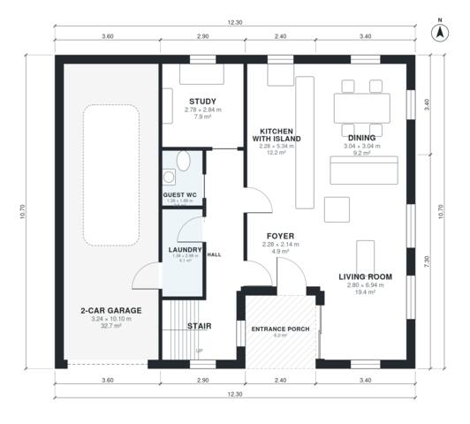

# 4 Bedroom Minimalist House Plans, 1,970 Sq Ft, 2 Story

This two-storey flat-roof house has about 180 m² of living space, excluding the attached 2-car garage. The ground floor has an open kitchen with island, dining and living area, plus a study, guest WC and laundry. Upstairs are the primary suite with dressing room and ensuite, three more bedrooms, a family bath and a large roof terrace.

| | |
|---|---|
| Levels | 2 |
| Footprint | 12.3 m × 10.7 m (40 ft × 35 ft) |
| Rooms | 19 indoor, 2 outdoor |
| Indoor area including garage, from the room grid | about 221 m² (2,382 sq ft) |

## Files here

- `area-schedule.csv` (room schedule)
- `building.json` (rooms, walls, openings as data)
- `plan-level1.dxf` (floor plan, DXF, drawing units: millimetres)
- `plan-level2.dxf` (floor plan, DXF, drawing units: millimetres)

## More for this plan

- Plan page with the PDF plan set, IFC and 3D model, and a tool to change the plan: https://floorplan.ai-architectures.com/house-plans/4-bedroom-minimalist-house-plans?utm_source=github-plans&utm_medium=probe&utm_campaign=github
- PDF plan set: https://storage.googleapis.com/20img/house-plans/4-bedroom-minimalist-house-plans/plan-set.pdf
- IFC model: https://storage.googleapis.com/20img/house-plans/4-bedroom-minimalist-house-plans/model.ifc

## Known issues in this drawing

- Living Room is 19.4 m² (asked for about 26.0 m²).
- Living Room is only 2.80 m wide.
- Family Bath is 3.7 m² (asked for about 5.5 m²).
- Bedroom 4 is 6.6 m² (asked for about 11.0 m²).
- Bedroom 4 is only 2.04 m wide.
- Bedroom 3 is only 2.04 m wide.

Concept design generated with AI. Not for construction or permit; verify with a licensed professional.
