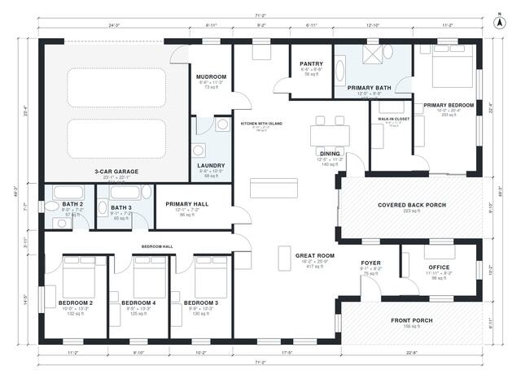

# 4 Bedroom Modern Farmhouse Plans: 2,560 Sq Ft Single Story

A single-story modern farmhouse of about 237 m² (roughly 2,550 sq ft) of living space, plus a 3-car garage and front and covered back porches. The great room, kitchen with island, and dining are open to each other, and the pantry, mudroom and laundry sit between the kitchen and garage. The primary suite and the three secondary bedrooms are in separate wings off the great room.

| | |
|---|---|
| Levels | 1 |
| Footprint | 21.7 m × 15.0 m (71 ft × 49 ft) |
| Rooms | 19 indoor, 2 outdoor |
| Indoor area including garage, from the room grid | about 290 m² (3,125 sq ft) |

## Files here

- `area-schedule.csv` (room schedule)
- `building.json` (rooms, walls, openings as data)
- `plan-level1.dxf` (floor plan, DXF, drawing units: inches)

## More for this plan

- Plan page with the PDF plan set, IFC and 3D model, and a tool to change the plan: https://floorplan.ai-architectures.com/house-plans/4-bedroom-modern-farmhouse-plans?utm_source=github-plans&utm_medium=probe&utm_campaign=github
- PDF plan set: https://storage.googleapis.com/20img/house-plans/4-bedroom-modern-farmhouse-plans/plan-set.pdf
- IFC model: https://storage.googleapis.com/20img/house-plans/4-bedroom-modern-farmhouse-plans/model.ifc

## Known issues in this drawing

- Primary Hall and Primary Bedroom are not directly connected.
- Dining has no window.

Concept design generated with AI. Not for construction or permit; verify with a licensed professional.
