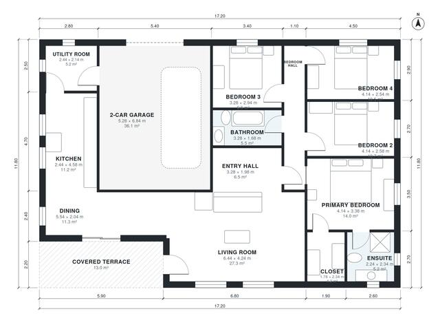

# 4 Bedroom One Story House Plans With Garage | 1,630 Sq Ft

This is a single-storey house of about 150 m² of living space, plus a 36 m² two-car garage and a 13 m² covered terrace. An open kitchen, dining and living area opens onto the terrace. The four bedrooms, family bath and a primary suite with ensuite and closet are grouped along one hall, away from the living space. The utility room links the kitchen to the garage.

| | |
|---|---|
| Levels | 1 |
| Footprint | 17.2 m × 11.8 m (56 ft × 39 ft) |
| Rooms | 14 indoor, 1 outdoor |
| Indoor area including garage, from the room grid | about 190 m² (2,045 sq ft) |

## Files here

- `area-schedule.csv` (room schedule)
- `building.json` (rooms, walls, openings as data)
- `plan-level1.dxf` (floor plan, DXF, drawing units: millimetres)

## More for this plan

- Plan page with the PDF plan set, IFC and 3D model, and a tool to change the plan: https://floorplan.ai-architectures.com/house-plans/4-bedroom-one-story-house-plans-with-garage?utm_source=github-plans&utm_medium=probe&utm_campaign=github
- PDF plan set: https://storage.googleapis.com/20img/house-plans/4-bedroom-one-story-house-plans-with-garage/plan-set.pdf
- IFC model: https://storage.googleapis.com/20img/house-plans/4-bedroom-one-story-house-plans-with-garage/model.ifc

## Known issues in this drawing

- Dining is only 2.04 m wide.

Concept design generated with AI. Not for construction or permit; verify with a licensed professional.
